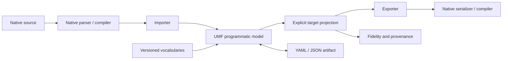
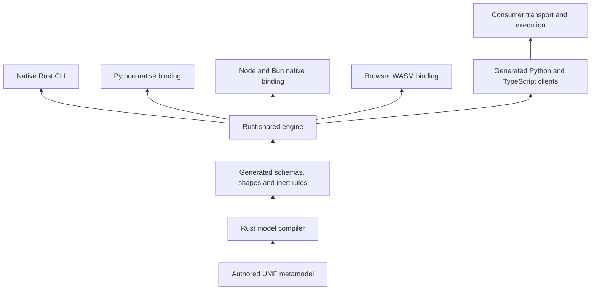

---
ddx:
  id: umf.architecture
  type: architecture
  activity: design
  status: draft
  authoring:
    home: repo
  links:
    - id: umf.prd
      kind: informed_by
    - id: umf.cross-cutting-requirements
      kind: informed_by
    - id: FEAT-006
      kind: informed_by
    - id: FEAT-005
      kind: informed_by
---

# UMF Architecture

## Scope

UMF is a lossless, extensible semantic interchange representation with a small
common core and independently versioned vocabularies. This design follows the
owner's bootstrap brief and [PRD](../01-frame/prd.md), constrained by
[NFR-1–NFR-50](../01-frame/cross-cutting-requirements.md).

The initial design and spike targeted the JSON Schema + Protobuf slice in FR-37.
JSON Schema is the JSON Schema project's schema vocabulary and validation
standard for JSON data. Protobuf is Google's Protocol Buffers serialization
and schema system. Native semantic models remain authoritative for native
meaning; neither system defines the worldview of UMF core.

The repository now implements a browser-compatible TypeScript library, compiled
to JavaScript, with Bun development/testing under
[ADR-002](adr/ADR-002-bun-development-runtime.md). Native compiler and database
oracles remain host-side evidence tools; optional native parsers use separately
built browser WASM. No production service or downstream execution engine is
specified. The initial spike is historical context, not the current library's
entire implemented scope.

This inventory describes the implementation merged through `0f20d2e4` and cites scoped feature evidence.
The [integrated acceptance](../../../fixtures/validation/relationship-integrated-acceptance-evidence.json) records the fresh native/browser replay, repository regression and six separate concept gates. Relationship ideal admission and qualified five-system delivery pass independently; native equivalence remains unclaimed.
Subsequent core 0.8.0 changes have separate
[scoped execution evidence](../04-build/evidence/schema-properties-core.md#current-only-key-tuple-correction-2026-10-06).
The earlier integrated acceptance qualifies its recorded source; fresh repository
regression and native qualification after API simplification and the current-only
Key tuple correction remain incomplete.
Package presence, structural validation, target generation and native equivalence
remain different claims.

## Level 1: System Context

### Proposed schema migration ownership

FR-18, FEAT-007 COMP-06–11 and [SD-007](solution-designs/SD-007-schema-migrations.md)
define the proposed field migration boundary. The portable library owns exact
source comparison, declared migration intent, dependency and loss analysis,
capability-qualified plan generation and receipt verification. Backend compilers
own physical lowering and version-specific operations. Execution hosts own
authenticated installation state, approval, data scans/transforms, writer
coordination, checkpoints, native validation, cutover and recovery. Optional
UMF-distributed host code follows this boundary; portable core remains free of
connections and storage execution under NFR-50.

Backfills, logical defaults and defaults for future native writes are separate.
Logical Field retirement, physical deletion and historical purge are separate.
Type conversion requires explicit meaning/loss rules and complete target checks.
No shared online, atomic or reversible guarantee is inferred across backends.
CONTRACT-046 remains observational; CONTRACT-081 governs the first table host
profile. The [migration plan](../04-build/schema-migration-plan.md) sequences
exact contracts, module/checker adoption and native qualification before support.

| Participant | Relationship to UMF | Boundary |
| --- | --- | --- |
| Schema authors and tooling | Create, inspect, validate, compare, and transform artifacts | Programmatic and human workflows; no mandatory UI |
| Native ecosystem tools | Parse, serialize, and evaluate native schemas | Reuse established native implementations where possible |
| Extension authors | Publish versioned vocabularies, rules, capabilities, and fixtures | Installation/trust decisions are independent of artifact contents |
| TableSpec | Intended producer/consumer of table and data definitions | Existing schemas must be inspected for compatibility |
| Axon | Intended consumer of domain, graph, authority, and physical bindings | Query/mutation execution belongs to Axon |
| Palantir Ontology | Later native operational-model interchange | Preserve declared exposed semantics; no generic-core promotion by assumption |

TableSpec and Axon roles are supplied by the owner. TableSpec now has pinned
native model/schema evidence within its qualified adapter subset; full consumer
integration and Axon runtime compatibility remain separate. Palantir coverage
depends on the selected public or
authorized native interface and version, not a claim about inaccessible internals.

The owner's intended Axon flow is: structural, graph, authority, relational-binding,
and Axon-native semantics feed a typed operational graph and logical query/mutation
model; heterogeneous physical execution remains in Axon. TableSpec produces and
consumes table/data artifacts as a peer rather than owning UMF's definition.

The brief names object types, properties, links, interfaces, value types, actions,
datasource mappings, and policy/capability metadata as Palantir preservation
candidates. This is an inventory to validate against the chosen native interface,
not a researched completeness claim or a list of mandatory core primitives.

## Proposed declarative action boundary

[FR-51/FEAT-900](../01-frame/features/FEAT-900-declarative-actions.md) introduces
a proposed independently versioned `umf.actions` extension. The feature-level
[SD-900](solution-designs/SD-900-declarative-actions.md) separates declaration
validation/inspection and profile comparison from consumer-owned execution.
[CONTRACT-900](contracts/CONTRACT-900-declarative-actions.md) owns exact action
semantics; [TD-900](technical-designs/TD-900-declarative-actions.md) describes the
bounded library slice. [CONTRACT-901](contracts/CONTRACT-901-transactional-action-profile.md)
adds a proposed bounded executable consumer profile, revision/protocol and
handler-access/audit requirements. These are design proposals, not delivered architecture.

Core Record/Field/Key and relationship assertions retain their own meaning.
Initial action references are document-local and require no US-050 implementation.
DDD operations become associated only through an explicit action binding.
Constraints and handler names are inert data: UMF supplies neither a general
rule evaluator nor a transaction engine. An executor capability match is a
self-declared claim over a retained exact document, not authorization or proof
of atomicity, replay or receipt freshness. Those need independent, versioned
consumer witnesses before any execution support claim.

## Level 2: Container Diagram

The implementation provides a browser-compatible library and host-side tooling
sharing the same programmatic model. No persistent service,
database, cloud runtime, or network registry is required by the brief.

| Unit | Technology Direction | Responsibility | Boundary |
| --- | --- | --- | --- |
| UMF shared engine and tooling | Rust engine, native CLI/Python/Node/Bun bindings and browser WASM under ADR-006; current TS engine migrates by qualified operation family | Model access, operations, diagnostics and generation | Generated metamodel rules; host I/O outside core; explicit native capability dependencies |
| Vocabulary packages | JSON Schema structural definitions plus semantic specifications | Versions, validation, capabilities, fixtures | Package metadata is data; it does not authorize code execution |
| Native adapters | Selected ecosystem parsers/compiler APIs | Import/export through native semantic representations | Native output must pass native validation |
| Conformance harness | Bun test runner; separate browser execution and pinned native oracles | Round-trip and projection evidence | Evidence generation is separate from support declarations |

## Level 3: Component Diagram

### Shared JavaScript numeric boundary

FR-8/39/41 and FEAT-005 IDEAL-08 place runtime numeric policy in a portable
library adapter over existing integer/decimal literals. CONTRACT-049 owns its
interface; [TD-054](technical-designs/TD-054-javascript-numeric.md) realizes the
bounded [US-054](../01-frame/user-stories/US-054-javascript-numeric.md) slice.
JavaScript number and bigint remain consumer representations. The adapter
checks exact binary64 value equality, safe integer admission and optional
current-Field constraints; it adds no vocabulary, scalar family, persistence
service or runtime dependency. Database transport/storage codecs stay in
Truss/Weft, with adoption by Truss, Ashlar and TableSpec evidenced separately.

The ordinary JSON envelope retains CONTRACT-001's existing numeric profile.
Exact values travel through string token carriers, never raw bigint. The shared
adapter's strict decimal admission is separate from generic programmatic JSON
number copying: the latter cannot recover precision lost before invocation.
Unknown extension/native meaning remains attached; relevant unknown qualifiers
block conversion instead of authorizing normalization. Core float instance
semantics and native binary32 narrowing remain separate policies.

| Component | Responsibility | Failure Boundary |
| --- | --- | --- |
| Document reader/writer | Preserve JSON-compatible data and uninterpreted extension content | Reject unsupported serialization constructs explicitly; never coerce silently |
| Programmatic model | Stable identities, references, core concepts, native vocabularies, and origins | Typed access must not discard fields outside the consumer's knowledge |
| Extension registry | Resolve declared identifiers/versions and capability descriptions | Missing versions, collisions, and conflicts are explicit |
| Validation coordinator | Distinct syntax, structure, reference, core, extension, and target checks | A successful structural check cannot certify semantic validity |
| Reference resolver | Explicit, deterministic packaged dependencies | Ambiguity fails; missing input never triggers arbitrary network traversal |
| Projection engine | Apply declared mappings against target capabilities | Approximation and non-expressibility remain visible |
| Diagnostics/provenance | Identify source and target concepts, rules, operations, and outcomes | Reports distinguish preservation in UMF from target behavior |
| Adapter pair | Import/export native meaning through the model | Native semantics remain source-specific where no safe common mapping exists |

### Core and vocabulary boundaries

The owner's 2026-09-21 priority remains TableSpec, PostgreSQL, SQL Server, Avro
and Parquet ingestion. Shared scalar families and authored ideals are implemented
without replacing native widths/ranges, decimal precision/scale, collation,
encoding or temporal behavior. The versioned envelope inventory is:

| Core version | Implemented authored surface | Boundary |
| --- | --- | --- |
| 0.1.0 | Original modules/elements/references, scalar-family metadata and native extension archives | Remains readable; references alone do not author relationships |
| 0.2.0 | Field/scalar authoring and explicit Record roles | Value families are classifications, not native domain equivalence |
| 0.3.0 | Nullability | Ideal availability differs from native missing/NULL/default/read contexts |
| 0.4.0 | Cardinality with item/value Field references | `one`/`array`/`map` shape is separate from relationship participation |
| 0.5.0 | Author-stated facets | Constraints retain explicit domains and unsupported/native-only refinements |
| 0.6.0 | Named stable Key identities and ordered Field components | Native indexes, comparison and NULL semantics remain qualified |
| 0.7.0 | Stable authored relationships between independently keyed Records | Target Key, participation, lifecycle, inverse and association Record intent do not imply physical enforcement |

The schemas in [spec/core](../../../spec/core/) and operations preserve older
versions through explicit migration/rollback receipts rather than silently
reinterpreting earlier documents. These envelopes remain experimental. Field
through Key have dated admission/five-system evidence, including the
[Key admission record](../04-build/evidence/key-gate-admission.md).
Relationship [core acceptance](../../../fixtures/validation/relationship-core-acceptance-evidence.json)
and individual bindings are delivered. The separate [relationship gate](../../../fixtures/validation/relationship-conformance.json) admits the authored ideal and qualified five-priority delivery with explicit residuals and refusals.

Core has two distinct gates. **Ideal admission** defines UMF meaning: a written
meaning, counterexamples, down-projections to at least two of the five priority
systems, and up-classification retaining unknown/native refinements. Native
agreement is not a prerequisite for UMF to define an ideal. **Equivalence
graduation** claims that core can replace a native concept; only this claim
requires multiple independent adapters mapping both ways without material semantic
change, migration, rollback and zero preservation regressions.

The Field → Nullability → Cardinality → Facets → Key sequence under CONTRACT-040
and TD-040–TD-044 has implemented schemas and APIs. CONTRACT-041 adds authored
relationships. Admission at two priority systems still does not complete delivery:
each ideal needs TableSpec, PostgreSQL, SQL Server, Avro and Parquet dispositions,
including explicit refusals/residuals. OWL, DDD lifecycle, physical encodings and
default-as-execution remain extension/native meanings.

Consumers read the ideal and adapters retain native representations (FR-20).
Ideal → native → ideal recovers the authored ideal or an explicit residual;
native → ideal → native recovers all native text/bytes outside the ideal's claim.
Strict mode blocks loss; report mode emits it. No core label deletes native data.

The current extension inventory is independently versioned. The following are
published packages, not a declaration that every native construct is supported:

| Package group | Package versions and scope |
| --- | --- |
| Domain and physical binding | `umf.ddd` 0.1.0; `umf.binding` 0.1.0 and stable-ID 0.2.0 |
| Priority native archives | `umf.tablespec`, `umf.postgresql`, `umf.postgresql.catalog`, `umf.sqlserver`, `umf.avro`, `umf.parquet`, each 0.1.0 |
| Priority ideal bindings | For each of `tablespec`, `postgresql`, `sqlserver`, `avro`, `parquet`: `umf.<system>.nullability`, `.cardinality`, `.facets`, `.keys`, `.relationships`, each 1.0.0; Field operations use their qualified native packages |
| Structural/API | `umf.json-schema`, `umf.protobuf`, `umf.graphql`, `umf.openapi`, `umf.typespec`, `umf.smithy`, each 0.1.0 |
| Storage/compute | `umf.arrow`, `umf.arrow.flatbuffer`, `umf.arrow.ipc`, `umf.spark`, `umf.delta`, `umf.delta.table`, `umf.delta.log`, `umf.iceberg`, `umf.iceberg.table`, each 0.1.0 |
| Data/semantic exchange | `umf.dbt.manifest`, `umf.dbt.artifact`, `umf.dbt.semantic`, `umf.odcs`, `umf.linkml`, `umf.rdf`, `umf.jsonld`, `umf.generalized-rdf`, `umf.shacl`, `umf.owl`, each 0.1.0 |

Package schemas, semantics and capabilities live under
[spec/extensions](../../../spec/extensions/). Native versions and qualified
subsets are operation-specific and recorded by their contracts/evidence; a
package version is not a native product version. No universal type lattice,
inference engine or single graph/relational interpretation is assumed.

Every extension package describes identity/namespace, version, structural
schema, semantic rules, validator capability, understood/emittable constructs,
applicable import/export directions, and real round-trip fixtures. Semantic
validator implementations are separately installed trusted tooling; the model
does not execute instructions carried by untrusted artifacts.

### Domain-driven design vocabulary

Domain-driven design (DDD) is implemented as the independent `umf.ddd` 0.1.0
semantic profile under FR-40 and CONTRACT-005. The authored flow is
`DDD model → core + umf.ddd → explicit target projections`. Source examples
and intent are retained in [discovery input](../00-discover/vision-input.md).

| Concept | Representation boundary |
| --- | --- |
| Entity, value object/type, identity, references/relationships, invariants/constraints, namespace/module | UMF ideals may classify these under FR-3 without replacing DDD meaning; native replacement requires FR-28 equivalence. Keep DDD-specific equality and lifecycle in the extension |
| Bounded context | DDD meaning attached to a module/namespace carrier; a namespace alone does not establish a bounded context |
| Aggregate root and boundary | Explicit root, membership, and invariant scope; independent of table, document, or graph layout |
| Domain service, repository, domain event | Domain declarations and relationships; no generated execution, persistence, messaging, or endpoint behavior implied |
| Context map and anti-corruption layer | Explicit context-qualified source/target references, mapping direction and limitations, and translation boundary intent |
| Ubiquitous-language terms | Context-scoped terms and definitions; aliases do not imply cross-context identity |

Keep `sales.Customer`, `support.Customer`, and `billing.AccountHolder` distinct,
even with identical properties. Context mappings can be partial and one-way;
reverse mappings require separate evidence. Do not equate DDD entities with
graph nodes, aggregates with tables, or repositories with API endpoints.

DDD describes meaning; core and extensions carry it; bindings describe its
physical representation; Axon/TableSpec and other consumers execute it. Axon
consumes the independent DDD vocabulary and cannot become its semantic authority.

| Order aggregate projection | Possible target shape | Fidelity obligation |
| --- | --- | --- |
| SQL | `orders` and `order_lines` tables | Retain aggregate membership and invariants separately; foreign keys do not establish aggregate enforcement |
| Document schema | Embedded order and lines | Embedding does not itself establish transaction/lifecycle semantics |
| Axon | Entities and relationships forming a subgraph | Preserve DDD intent independently of Axon's execution rules; exact Axon interface unresolved |
| OpenAPI | Explicit command operations and data transfer objects (DTOs) | DTO structure does not express aggregate consistency; operations require mapping decisions |
| Palantir | Aggregate root as Object Type; selected operations as Actions | Candidate mapping only; native action behavior, authority, and enforcement require separate evidence |

The synthetic DDD corpus includes Order, OrderLine, ShippingAddress, Money, an
OrderPlaced event and separate sales/support Customer definitions with a partial
context mapping. CONTRACT-005 defines identity/equality, root and membership,
invariant scope, events, terminology and mapping direction. Invariants may be declarative or
opaque expressions: preserve their language/version and interpretation status;
structural validation is not execution or proof of the domain rule.

No universal native DDD serialization is claimed. The published UMF-authored
DDD profile has semantic fixtures; external DDD tool formats require separately
named evidence. A profile round trip cannot
claim compatibility with all DDD tools. An unedited stored source blob alone
does not satisfy typed access, edit propagation, or semantic validation.

Equivalence graduation (not ideal admission) requires documented semantic preconditions, counterexamples,
two independent extension mappings in both directions, migration and rollback
fixtures for earlier artifacts, and zero native/unknown-content regressions.
Identity of a schema element is not automatically DDD entity identity; JSON
Schema value constraints do not automatically express aggregate invariants.

### Authored relationships and independent physical binding

DDD concept references use explicit context-qualified `{module, element}`
identities. They remain a qualified DDD binding of association-like meaning:
multiple referenced concepts do not silently author a core relationship, and a
core record-valued Field denotes containment by value. Authoring a core
relationship requires the separate stable assertion and target Key under
[CONTRACT-041](contracts/CONTRACT-041-relationship.md). Native FKs, GraphQL object
fields and DDD references remain observations/declarations in their own domains
unless explicit authored intent supplies that assertion. Aggregate membership,
lifecycle and entity equality remain DDD meanings rather than universal core or
storage rules.

[CONTRACT-042](contracts/CONTRACT-042-physical-binding.md) implements a separate
`umf.binding` document paired to one explicitly supplied logical model. Several
target bindings can coexist without editing that model. Version 0.1.0 uses
relationship presentation names; 0.2.0 (`umf-binding-2`) uses exact stable IDs.
Migration resolves unique names against the exact logical model, retains the
original and records mappings; rollback restores it while retaining later edits
as explicit residuals. See [stable-ID browser evidence](../../../fixtures/binding/stable-ids/browser.json)
and [binding tests](../../../tests/binding/). Filter/sort/index capabilities belong
to the selected target binding; a logical Field alone does not establish them.

The five priority relationship bindings have scoped independent native/browser
evidence. Their native classification and authored projection remain separate:

| Target and pinned evidence | Delivered relationship subset and limits |
| --- | --- |
| [TableSpec revision `647e8e566ad78b864282ec65c0b0b2237aa63084`](../../../fixtures/validation/relationship-tablespec-acceptance-evidence.json) | Declared metadata classification and outgoing Key metadata; no referential enforcement; heterogeneous/keyed association layouts refuse |
| [PostgreSQL 17.4](../04-build/evidence/postgresql-relationship-acceptance.md) | New keyed ordinary tables with explicit FK/junction carriers; catalog/DDL classification retains actions, NOT VALID and MATCH SIMPLE refinements |
| [SQL Server 2022, 16.0.4295.3](../04-build/evidence/sqlserver-relationship-acceptance.md) | Integral-Key new-table FK/junction carriers; native trust/enabled/actions and unknown catalog observations remain explicit |
| [Avro 1.12.0 / fastavro 1.12.2](../../../fixtures/validation/relationship-avro-acceptance-evidence.json) | Grammar observations and explicit target-Key record carriers; no reference/participation enforcement |
| [Parquet / PyArrow 21.0.0](../04-build/evidence/parquet-relationship-acceptance.md) | Physical-schema observations and nested target-Key schema carriers; no dataset referential enforcement |

Additional [GraphQL/RDF/LinkML relationship evidence](../../../fixtures/validation/relationship-extras/acceptance.json)
uses graphql-js 17.0.2 with graphql-core 3.2.12, RDFLib 7.6.0, and LinkML
metamodel 1.11.0/runtime 1.11.0rc2. These are qualified schema/triple/metadata
bindings, not replacements for priority-system delivery. RDF domain/range can
support inference rather than closed-world validation; LinkML range metadata is
not instance validation; GraphQL schema fields supply neither resolvers nor
Key resolution.

### Delivered directed generators

`projectDddToPostgresql` composes DDD, core relationships and separate binding
under [CONTRACT-043](contracts/CONTRACT-043-ddd-postgresql.md). Its
[PostgreSQL17.4 whole-generator evidence](../04-build/evidence/ddd-postgresql.md)
covers bound tables/scalars/JSONB checks, exact ordered Keys, FK/junction/keyed
association attributes, homogeneous shared discriminator-edge tables, eligible
LIST/default partitions and each declared index's emitted or residual outcome.
Partitioned Keys must already contain the partition column; they are never
widened. Heterogeneous endpoints and association-edge layouts refuse. DDD
invariants, lifecycle, comparator/domain differences and inline storage remain
explicit residuals; generated SQL is not a deployed database migration.

The [SQL Server 2022 physical generator](../04-build/evidence/sqlserver-physical-binding-acceptance.md)
composes ordinary tables, JSON text carriers, exact Keys, FKs, keyed associations,
anonymous pair-unique junctions, bounded shared edges and supported rowstore
indexes against 16.0.4295.3. Partitioned-Key layouts remain blocked. Its pair
identity and native bounds are target-specific; they are not inferred universal
relationship meaning. Delta 3.2 clustering, Iceberg v3 sort-order and Parquet 2.9
physical-binding dispositions retain their separate qualified contracts and
residuals under CONTRACT-042.

`projectDddToGraphql` under [CONTRACT-044](contracts/CONTRACT-044-ddd-graphql.md)
generates complete schema SDL from explicit DDD/core Field/relationship/naming
and root policies, independently of physical storage. The
[full-generator acceptance](../../../fixtures/projections/ddd-graphql/acceptance.json)
uses graphql-js 17.0.2 and independent graphql-core 3.2.12. It includes explicit
union/orientation policies and retains unsupported identity, participation,
lifecycle and association obligations. It generates no resolvers, query execution
or relationship enforcement.

Each complete generator retains copied sources, source-linked losses, exact
output and verified recovery receipts. Strict mode refuses remaining gaps;
report mode produces only the supported complete candidate with explicit losses.
Target-only reimport cannot reconstruct authored intent that the target lacks.
Native schema acceptance, browser parity and retained recovery do not establish
native-equivalence graduation. Fresh combined verification is separately recorded in the integrated acceptance above.

### Serialization and validation

YAML-first authoring loads a JSON-compatible document, undergoes JSON Schema
structural validation, and then version-aware semantic validation over the
programmatic representation. See [ADR-001](adr/ADR-001-bootstrap-representation.md).
The diagram describes validation stages, not a mandate to delay all model
construction until semantic validation finishes.

Foreign-key compatibility, identity and reference validity, cross-definition
invariants, and native field-number or ontology constraints belong to semantic
validators. Structural schemas must not impersonate full native validation.
Duplicate keys, non-JSON YAML values/tags, aliases/cycles, numeric precision,
reference base resolution and preservation rules are governed by the implemented
serialization contracts. Unsupported or ambiguous constructs must refuse explicitly
rather than silently accepting parser-specific behavior.

### Programmatic metamodel and metadata consumers

FR-41 requires programmatic traversal, selection, composition and safe editing
across core and understood vocabularies. Core plus extensions carries the
representational superset of native storage and compute shapes, including
competing meanings and content a consumer cannot yet interpret. Adding a new
system does not authorize collapsing existing distinctions or discarding unknowns.

Consumer projections extract the metadata needed for transforms, visualization,
pipeline and validator generation, forms, AI-agent context, and human documentation.
Preserve context-qualified identities, reference dependencies, relevant constraints,
origins and interpretation status. Declare whether a projection includes referenced
definitions or retains external references; a dangling or omitted dependency must
be explicit. Metadata selection is not an implicit destructive rewrite of the source.

Use the same model API for these consumers rather than requiring native-format
parsing or human-document scraping. Keep declared and inferred metadata distinct.
Generated artifacts carry mapping/coverage limits; an unknown invariant cannot
become an asserted form rule, validator guarantee, or agent fact. Consumer code
executes pipelines, renders views, and hosts applications; UMF represents and
provides the metadata and transformations they use (NFR-50).

### Import, projection, and export

Conceptually, `decodeS` imports and `encodeS` exports. The native guarantee is
`encodeS(decodeS(x)) ≡S x`, with native-system/version equivalence and declared
subset boundaries. A common in-memory model is an API abstraction, not a
single canonical semantic interpretation and not a requirement to load an
entire schema catalog into memory.

Prefer native parsers and serializers: descriptor APIs for Protobuf, native
schema/abstract syntax tree libraries for API languages, established ontology
libraries and captured database catalogs. Selected libraries, native pins and
qualified subsets are recorded in each adapter contract and fixture manifest;
new integrations still require separate selection and evidence.

Projection produces a target view from source vocabularies plus common concepts.
It must retain the source representation and report exact preservation,
equivalent mapping, approximation, preserved-but-inexpressible content,
incompatibility, and unsupported semantics. Conceptual categories are governed
by FR-9 and the versioned fidelity/projection contracts; exact receipt fields
and diagnostics belong to their schemas rather than this overview.

An incomplete projection is not a successful lossless conversion. Strictness
controls whether output may be produced; it never suppresses diagnostic truth.
The output's native validator checks target validity independently of fidelity.

Retaining the UMF source enables returning home; the standalone target may
not. The export packaging/association contract must make clear whether a future
consumer needs the retained UMF artifact. Do not promise source recovery from
target-only reimport when the target cannot carry that meaning.

## Deployment

Core, validation, and in-scope adapter transformations must execute in a browser
from supplied artifacts and packaged references, without requiring a server or
Bun-specific globals or Node.js filesystem/process APIs. Keep CLI file access and native compiler
invocation in host-specific tooling. Prefer browser-compatible parser libraries;
WASM is available when an adapter needs it, not a required core build target.
Independent native oracles may run on development/test workers; that does not
establish browser support for the adapter itself.

Execution also targets developer machines and automated test workers
with locally installed native tools and packaged references. No production
service is specified. Each run receives explicit artifacts, versions,
configuration, and resource limits. Artifacts and fixture evidence live in
source control or declared result storage; backup operations belong to the
hosting environment. Concurrency must not change semantics. Supported operating
systems, browser/runtime versions, and numeric resource budgets remain open.
Prioritize fidelity, simplicity, and browser usability over high throughput;
resource limits and transparent expensive operations remain required.

## Data Flow

1. Resolve a declared native dialect/version and parser configuration.
2. Parse source to its native semantic model; retain origins and required dependencies.
3. Import to the UMF model, preserving native-only and unknown extension content.
4. Run structural, reference, and applicable semantic checks separately.
5. For native return, export through the native model/serializer and compare
   using the native oracle. For cross-system output, project onto target capabilities first.
6. Emit native output plus fidelity/provenance evidence, identifying preservation
   outside the target and any unsafe or incomplete operation.

## Quality Attributes

| Attribute | Target | Strategy | Verification |
| --- | --- | --- | --- |
| Native fidelity | 100% pass within declared tested support; zero concealed exclusions | Native oracles and feature manifests | TP-001 native suites |
| Translation accountability | Zero unreported known mismatches in corpus | Concept-level fidelity and provenance | TP-001 projection tests |
| Unknown preservation | Zero unauthorized content loss | Model access preserves uninterpreted values | Parse-edit-write regressions |
| Reproducibility | Equivalent semantic results for identical declared inputs | Version/configuration pinning and explicit dependencies | Fresh-environment and offline reruns |
| Resource safety | Bounded by explicit run limits; numbers still open | Controlled resolution, depth/expansion limits | Adversarial fixtures; limit outcomes cannot report complete success |
| Minimal participation | Selected vocabularies operate without loading all others | Registry and operation-local understanding | Minimal-implementation conformance cases |

## Decisions and Tradeoffs

| Decision | Status | Rationale | Follow-up |
| --- | --- | --- | --- |
| Shared Rust execution with browser WASM | ADR-006 supersedes the TypeScript engine preference; browser target remains required | One engine for CLI, Python and Node/Bun with no Python V8 requirement | Qualify bindings, browser loading and every ported native subset before cutover |
| Bun development and testing runtime | Accepted in ADR-002 | Explicit owner direction | Pin Bun and dependencies; retain independent browser/type-check gates |
| Small core plus versioned semantic vocabularies | Implemented envelopes and packages | Preserve multiple native semantic systems | Retain distinct admission, delivery and equivalence gates |
| YAML-first, JSON-compatible bootstrap | Accepted direction in ADR-001 | Preserve human interchange and existing approach | Specify serialization edge cases |
| Native-semantic round-trip oracles | Owner-directed | Text equality is insufficient | TP-001 defines bounded oracle claims |
| Native libraries before new parsers | Preferred direction | Reuse ecosystem interpretation | Select versions and verify browser compatibility; keep independent native oracles in the harness |
| TypeSpec as interchange, not defining metamodel | Owner-directed | Avoid privileging its model absent fidelity evidence | Reconsider only with metamodel-wide evidence |
| LinkML as interchange and benchmark | Owner-directed | Learn from existing generators and compliance evidence | Measure actual semantic gaps; do not assert superiority |
| Runtime execution outside UMF | Required by NFR-50 | Preserve interchange boundary | Axon/TableSpec execution remains downstream |
| Self-description | Current descriptive core projection, FR-35 | Test the model with its own vocabulary | Retain exact bootstrap constraints; no authority transition |

### Ecosystem direction and remaining expansion

The sequence below records the owner's original pressure on the model; it is not
a current unimplemented backlog or release schedule. Several named systems now
have the qualified packages above. Each new support claim requires versions,
subsets and evidence; native equivalence requires its separate gate. The first
spike used JSON Schema and Protobuf.

| Phase | Candidates | New pressure on the model |
| --- | --- | --- |
| 1: Structural | JSON Schema, Avro, Protobuf | Primitives, records, enums, unions, presence, defaults, annotations, evolution |
| Early semantic slice, after JSON Schema + Protobuf | DDD (`umf.ddd`) | Context-specific identity/equality, aggregates, invariants, events, context maps; no storage dependency |
| 2: Graph/API | GraphQL schema definition language, OpenAPI, TypeSpec, Smithy | References, interfaces, operations, services, traits/decorators |
| 3: Physical data | PostgreSQL catalog/SQL, Spark StructType, Arrow, Delta, Iceberg, dbt | Keys, relationships, physical types/storage, indexes, table metadata |
| 4: Semantic | LinkML, Resource Description Framework (RDF), Web Ontology Language (OWL), Shapes Constraint Language (SHACL) | Class and graph models, logical semantics, constraints |
| 5: Operational | Palantir Ontology, Axon | Identity, authority, interfaces, bindings, query/action descriptions, policies |

Parquet and Open Data Contract Standard (ODCS) now have qualified packages; CUE
remains an additional candidate from the brief. Their position in this historical
sequence does not expand any current support subset.

### Repository responsibilities

`spec/core/`, `spec/extensions/` and `spec/projections/` hold normative schemas,
packages and complete projection contracts. `src/model/`, `src/validation/`,
`src/registry/`, `src/adapters/`, `src/core-ideals/`, `src/extensions/` and
`src/projections/` implement the portable library. `native/` and `scripts/`
contain optional runtimes and host-side evidence harnesses. `fixtures/` and
`tests/` retain native, directed-projection, browser and regression evidence.
Governed documents remain under `docs/helix/`; methodology stays in the installed
HELIX plugin rather than being copied into the repository.

### Remaining design and verification gates

The delivered inventory does not settle all product requirements. New adapter
subsets still require explicit native/browser evidence, unknown-content edit
rules and resource bounds. Native-equivalence graduation remains separate from
implemented classification and useful lossy projection. The relationship gate and final integrated refresh are recorded separately in [the implementation plan](../04-build/implementation-plan.md). Earlier feature acceptance records retain their original scopes and counts; they are not relabeled as the fresh combined result.

## Shared Exact JSON Helper (2026-09-20)

JSON Schema, Avro and OpenAPI now share `src/model/native-json.ts` and the identical
node definitions published as `spec/core/native-json.schema.json`. The old JSON
Schema helper import remains a compatibility export. A regression verifies encoding
identity and exact numeric preservation. OpenAPI adds JSON-compatible YAML parsing
into that same representation. This promotion is limited to JSON data representation;
it does not merge API, storage, domain, defaulting or coercion semantics.

TypeSpec now offers a separate pinned JSON Schema native emission API alongside no-emit
compilation and semantic inspection. It captures output files in memory, retains source,
requires explicit integer representation and reports incomplete semantic coverage.
CONTRACT-013 distinguishes native emitter evidence from a future loss-audited projection.

Smithy uses the shared NativeJson tree for its native JSON AST, with a separate
structural schema and incomplete semantic reports (CONTRACT-014). JVM assembly is a
development oracle, not a browser dependency. Candidate edits explicitly defer native
reference/trait validation; no source-retention evidence justifies new core semantics.

Smithy now separates archive/AST inspection from explicit native assembly. The public
TypeScript operation accepts a trusted installed backend; the pinned JavaScript port
is built and loaded separately. Assembly returns source, exact native model JSON, a
UMF AST model and native diagnostics with locations. Failures expose no partial model.
Runtime limitations and mixin normalization remain explicit; asynchronous typing alone
does not provide worker isolation or cancellation (CONTRACT-014, SPIKE-002).

## Shared schema properties (core 0.8.0)

CONTRACT-049 extends authored metadata with title, aliases, typed examples,
allowed-value sets, exact integer/decimal ranges, collection size, minimum
string/binary length and literal defaults with explicit missing/null triggers.
A separate portable literal validator checks understood values; an explicit
resolver performs copied literal substitution without storage or I/O.
Older envelopes require collision-archiving upgrade and retained rollback.
Document read/write and element selection recognize 0.8.0; previous versioned
native bindings and authoring APIs keep their scoped versions and refusal rules.
This is a core task, not a native-admission or TableSpec-port claim.
See [the execution evidence](../04-build/evidence/schema-properties-core.md).

### Routine metadata API amendment (2026-10-05)

Owner direction removes persistent element/relationship selection verification
and schema-property declaration receipts. Selection returns copied snapshots;
`declareCoreSchemaProperties` returns the copied validated Document. Migration
and native-conversion preservation records remain. Unknown length units make
validation incomplete even with minimum-only or zero-maximum bounds, so
extension editing refuses. Current scoped evidence and historical qualifications
are recorded in [schema-property execution evidence](../04-build/evidence/schema-properties-core.md).

### Official Python package and consumer extensions

The owner selects a Python package under `python/` beside the browser library.
Pydantic supplies ergonomic models; versioned `spec/core` JSON Schemas are the
structural authority and are copied into wheel resources at build time. Python
MUST NOT depend on TableSpec or a JavaScript runtime. Extension schemas and
validators are supplied explicitly by consumers, never loaded from document data.
TableSpec retains its extension and pipeline models in its own repository. Its
legacy compiler view is derived from the current shared document, with explicit
refusal for unsupported core semantics. Legacy files remain a compatibility
surface; UMF-native files are read and written without stripping unknown content.

### Portable domain-pack ownership

Owner direction on 2026-10-08 assigns portable pack schemas and schema-generation
tooling to UMF. CONTRACT-052 defines versioned declarative metadata. The
browser library emits the Draft 2020-12 schema; a development script publishes
its canonical standalone and extension-package forms. Python packages the same
schema resource. Generator references are opaque metadata, resolved only by an
explicitly installed consumer registry. No artifact imports code or fetches its
schema references. TableSpec owns tabular data generation, CSV ZIP output,
ingestion and data testing; Truss/Ashlar own ontological sample data. Consumer
schema snapshots are generated artifacts, not competing structural authorities.

Dataset source references form a reusable document-scoped extension with separate
origin and data-kind declarations. Packs can reference published synthetic fixtures,
observed data or mixed sources without conflating origin with privacy/realism.
Revision/checksum, rights notices and transformation provenance remain metadata.
Consumers explicitly bind local files or install retrieval adapters; metadata never
imports a downloader. The initial legal pack and its native TableSpec schema
artifacts live in UMF; consumer copies are exported and checked from that source.

The medical pack extends the same source model with curated official Health Level
Seven (HL7) Fast Healthcare Interoperability Resources (FHIR) R4 4.0.1 examples.
Source-scoped native keys, original JSON bytes and partial temporal/exact decimal
text prevent a scalar table projection from silently losing source meaning.
Unresolved native references are explicit rows, not fabricated entities. TableSpec
shares its spool, constraint checks, CSV ZIP exporter, SQL loader and Sail/Spark
test lanes across generated legal and externally sourced medical data. Archive
input snapshots retain source hashes independently of standardized CSV output.

The legal mixed pack separates generated firm-operation tables from observed
`cases`, `evidence_documents` and `evidence_pages`. Original public PDFs remain
authoritative; page text is a lossy search projection, preserving PDF page
ordinals and candidate Bates identifiers without inventing transcript citations
or discovery-production history. Local projection tooling never fetches sources.
Unknown third-party redistribution rights block full source export.

## Domain pack ontology targets

[SD-026](solution-designs/SD-026-domain-pack-platform.md) and [CONTRACT-053](contracts/CONTRACT-053-domain-pack-profiles.md) add explicit tabular and graph schema targets to portable packs. UMF owns domain ontology schemas using existing core Records/Fields/Keys/Relationships and native ontology vocabularies as applicable. TableSpec owns tabular replay; Truss/Ashlar own binding acceptance, graph storage and execution. Schema-targeted graph candidates are not native storage IDs or accepted catalogs. Source/run integrity and mixed-schema archive closure remain shared boundaries.

## Proposed typed data access SDK

FR-52 to FR-55 and FEAT-028 to FEAT-031 add a schema-first Python data access SDK.
[ADR-004](adr/ADR-004-typed-data-access-sdk.md) records the decision. Stage one is
currently a TypeScript generator, migrating to the shared Rust engine under
ADR-006; `umf_access` supplies Python host integration and existing compatibility
surfaces in this repository. Weft owns
all SQL lowering; Truss and Ashlar own their adapters.
[Design entry point](../04-build/typed-persistence-design.md).

FR-56 and [FEAT-033](../01-frame/features/FEAT-033-generated-ontology-access.md)
add typed ontology access generated directly from current UMF schemas. A shared
API description drives standard-library Python and TypeScript clients; consumers
implement transport and execution. [SD-033](solution-designs/SD-033-generated-ontology-access.md)
explains generation, async plugin calls, values and failures. Tables and ontologies share the generated model/query/action API; the binding
owns storage-specific execution. ADR-004 replaces mandatory query capture with
direct expression composition and optional backend preparation.

## Module Boundaries

### Saga analysis and consumer coordination (proposed)

Owner direction on 2026-10-29 keeps actions and saga semantics in this UMF
repository with shared generated types, core 0.10.0 schemas and one semantic
engine. The SDK candidate joins the 0.10 release series; no independent
umf-actions repository/package lifecycle is selected. Vocabulary and protocol
identities retain their distinct meanings and qualification requirements.

[SD-901](solution-designs/SD-901-saga-semantics.md) and
[CONTRACT-908](contracts/CONTRACT-908-saga-semantics.md) add independently versioned
composition semantics without moving durable execution into UMF. The new shared
operation family follows ADR-006; TypeScript/Bun wrappers and browser WASM retain
ADR-002's actual-browser qualification boundary.

| Module | Owns | Allowed | Forbidden |
| --- | --- | --- | --- |
| `crates/umf-codegen/src/actions/saga/` (planned) | Immutable declaration/reference/type/obligation analysis and safe copy/edit | Parent Rust action inspection, core values and generated package data | Native drivers, scheduler, authority queries, network, process or artifact-driven code loading |
| `src/extensions/actions/saga.ts`, core bindings (planned) | Typed host-value/wire presentation of shared Rust operations | Public shared engine and existing exact-admission/wire conventions | Separate TS/Python saga semantic implementation; provider runtime types |
| Trusted consumer coordinator (consumer-owned) | Scoped original submit/control custody, ticket admission, cancellation, fences and protected history | Explicit installed provider and authority dependencies | Import into portable library; document-selected physical resources or credentials |
| Qualified provider gateway (consumer-owned) | Current tx/1 native admission and atomic effect/original outcome | Native store/authority/custody adapters | Inferring native admission from a coordinator ticket or widening action atomicity |

Construction remains host-owned. The parent action inspection interface must be
promoted narrowly without exposing generator internals or duplicating its rules.
Before source implementation qualifies, extend `bun run check:rust-boundaries`
with negative controls for the new family and wrapper semantic forks. Current
checker success does not prove those planned controls exist. No runtime service
or architecture-model implementation evidence is claimed by this proposed map.

### Extension-defined kinds (proposed)

[CONTRACT-907](contracts/CONTRACT-907-extension-defined-kinds.md) defines
package-owned kind catalogs and generic discovery through existing extension
payload tags. [The design](plan-2026-10-22-extension-defined-kinds.md) maps the
explicit registration and qualification. This extends the existing
registry boundary; it introduces no ecosystem kind enum, second kind registry,
owner classification field or artifact-directed validator loading.

| Module | Owned responsibility / public boundary | Allowed dependencies | Forbidden dependencies |
| --- | --- | --- | --- |
| `crates/umf-core/src/{registry,kinds}.rs` | Immutable registered catalogs and exact kind identities; CONTRACT-907 list/get/inspect operations | Core values, Context, generated package policy, existing registry and validation APIs | Adapters, dashboard literals, filesystem/network/process, binding runtimes |
| `crates/umf-core/src/{constraints,engine}.rs` | Generic kind/tag/scope mechanics at existing extension validation boundary | Authored/generated policy, registered catalogs, explicit semantic capabilities | Per-ecosystem branches, manifest-selected code, a parallel payload-schema path |
| `crates/umf-core-wire`, `bindings/core/{python,node,wasm}` | Complete manifest transport and language presentation | Public shared engine APIs, existing exact admission and callback protocol | Duplicated kind resolution/validation or lossy manifest reconstruction |
| `spec/metamodel/umf.yaml`, compiler | Package/catalog/result shapes and diagnostic policy; generated outputs | Closed authored vocabulary and generic compiler mechanics | Hand-maintained generated schemas/types/rules |

Construction remains host-owned: callers install exact packages and trusted
validators in the existing registry. The extension publisher owns kind meaning,
payload schemas, native behavior and data-shape bindings. Core Record/Field
semantics are independent of extension classification. New handwritten kind
mechanics belong to Rust under ADR-006; the retained TypeScript engine does not
gain a second implementation.

Before dependent implementation, extend `bun run check:rust-boundaries` for
these paths and new binding exports. Add negative controls for adapter imports,
dashboard-specific generic branches, wrapper semantic forks and dropped catalog
metadata. Existing checker success does not prove these new controls exist.

### Existing compiler and SDK boundaries

**Source Applicability**: source; the stage-one compiler and Python access SDK
contain handwritten source. This is the bounded adoption scope selected in
Concerns; it does not baseline unrelated legacy modules.

Python paths below are relative to `python/umf_access/src/umf_access/`.
The checker also admits the earlier direct `python/umf_access/` layout, rejects
duplicate module identities across layouts and refuses empty scans. Only the
distribution's tests, caches, virtual environment and output directories are
excluded; unknown source-module owners refuse.

| Module | Responsibility / Owned Types | Public API | Allowed Dependencies | Forbidden Dependencies |
| --- | --- | --- | --- | --- |
| `src/compilation/admission/` | Admission, access validation, closure, census | `admission/index.ts`; CONTRACT-067/070 | Own internals, IR public barrel, named public semantic exports via barrel or identity-checked leaf imports | Emitters, bundle, host I/O |
| `src/compilation/ir/` | Immutable resolved nodes, provenance, obligations | `ir/index.ts`; private compiler representation | Own internals; erased public semantic types via barrel or identity-checked leaf imports | External values, renderers, host globals |
| `src/compilation/targets/python/` | Python source emission | `targets/python/index.ts`; CONTRACT-068 output | Own literal renderer, IR public barrel, generated `CURRENT_CORE_VERSION` for emitted metadata | SQL lowering, execution, host I/O |
| `src/compilation/bundle/` | Manifest, source archive, portable hashing | `bundle/index.ts`; CONTRACT-067 results | Own internals, IR and Python target public barrels | Filesystem, external host dependencies |
| `src/model/internal/accounting-context.ts` | Private six-method erased work-accounting contract | Named internal interface only; absent from the root public barrel | Erased `AccountingContext` type only in `src/compilation/bundle/hash.ts` and `src/extensions/tables/{context,index}.ts` | Value imports, exports/re-exports, other symbols or consumers, request/DTO/callback/meter authority, host facilities |
| `src/compilation/index.ts` | Generator facade and trusted composition | `generateAccessPackage`; CONTRACT-067 | Public compilation barrels, named public UMF exports via barrel or identity-checked leaf imports | Artifact-selected loading, host I/O |
| `scripts/umf-access-generate.ts` | Host writer and drift check | `generate`/`check`; CONTRACT-067 | Generator facade and host APIs | Semantic reimplementation; reviewed host boundary |
| `types.py`, `values.py`, `codec_support.py` | Shared carriers, strict values, codec revalidation; foundation owner | Named top-level modules; CONTRACT-068/072 | Other foundation modules, standard library, Pydantic | DSL, capture, drivers, Weft, host I/O |
| `dsl/`, `capture.py` | Typed expressions and in-memory declaration capture; DSL owner | `dsl/__init__.py`, `capture.py`; CONTRACT-071 | DSL internals, foundation, pure standard library, Pydantic | Drivers, Weft, network/filesystem, dynamic loading |
| `build/` | Catalog compilation | `build/__init__.py`; CONTRACT-071 | DSL, runtime, foundation public APIs; pinned Weft; standard-library file writing | Drivers, network |
| `runtime/`, `protocols.py`, `pages.py`, `adoption.py` | Protocols, outcomes, catalog execution and continuations; runtime owner | `runtime/__init__.py`, named helpers; CONTRACT-072 | Own internals, DSL and foundation public APIs | Host I/O, SQL assembly; Weft except exact `runtime/bulk.py` |
| `runtime/bulk.py` | Instantiate and verify bulk plans | Runtime-owned bulk boundary; CONTRACT-071/072 | Runtime dependencies plus pinned Weft only here | Read/action Weft use; competing SQL lowering |
| `targets/` | Raw-table integration and native execution | `targets/__init__.py`; CONTRACT-072/073 | Runtime, DSL, foundation public APIs; standard library, optional psycopg/Databricks/PySpark drivers | Generated packages by name; engine internals |
| `conformance/` | Shared adapter conformance | `conformance/__init__.py`; CONTRACT-069/072 | Runtime/foundation public APIs, pure standard library, Pydantic | Engine internals and host I/O |
| `__init__.py` | SDK public re-exports | CONTRACT-068/071/072 exports when implemented | DSL, runtime and foundation public APIs | Build/compiler dependencies, drivers |

Named leaf imports are admitted only when TypeScript resolves the imported symbol to the same symbol exported by `src/index.ts`; exposing a symbol in a leaf alone does not make it public. Admission and the facade use this to avoid eager initialization of every adapter. IR dependencies remain erased types (including an erased `typeof` current-marker query); the Python target may load only the generated current marker for metadata. Private, default, namespace and side-effect leaf imports remain refused, together with cross-owner internals and host I/O. The sole private erased-type route is the named `AccountingContext` interface from `src/model/internal/accounting-context.ts`, resolved to that exact declaration and consumed only by the bundle hash kernel plus the table extension context/index. It supplies six optional work-accounting methods to internal implementations; it is absent from the root public barrel and grants no request, DTO, callback or meter authority.

**Integration Owners**: Weft -> Python `build/` and the exact `runtime/bulk.py`
exception; raw-table drivers -> `targets/`; Truss/Ashlar -> their own repositories'
adapters over CONTRACT-072. Engine storage is never a binding target.

**Construction Policy**: `src/compilation/index.ts` composes the pure generator;
the host writer owns filesystem operations. Hosts supply runtime targets and
connections explicitly. No generated package holds connections or table handles.
Cross-module imports use `index.ts` or Python package/top-level public boundaries;
all cycles refuse, including type-only cycles.

**Boundary Check**: `bun run check:access-boundaries` runs
`bun scripts/check-compilation-boundaries.ts` and
`python3 scripts/check-access-python-boundaries.py`. The same command is wired
in `.githooks/pre-commit` and `.github/workflows/access-boundaries.yml`.
`bun run test:access-boundaries` executes the actual checkers, including a
temporary Git repository with the installed hook and injected TS/Python failures.
Hook installation is local: `git config core.hooksPath .githooks`; it is not
silently installed into the integration checkout's shared Git configuration.

The TypeScript checker uses the pinned compiler API for import/re-export/type
imports and aliases. The Python checker uses `ast` without importing SDK modules.
Both check graph cycles and cross-module private imports. Portable TypeScript
host/network/code-execution identifiers and Python pure-layer host I/O and
dynamic-loading APIs refuse. These static checks are dependency enforcement,
not a sandbox: reflective/deliberately obscured calls, arbitrary object private
access, transitive behavior of existing public APIs, runtime SQL assembly,
generated table handles, and engine-storage access require semantic review and
behavioral gates. B-TP-000 evidence qualifies enforcement, not SDK functionality.

## Generated reference consumer boundaries

[FEAT-032](../01-frame/features/FEAT-032-generated-reference.md) adds a static
metadata consumer. [SD-032](solution-designs/SD-032-generated-reference.md) owns
the feature approach; [CONTRACT-077](contracts/CONTRACT-077-generated-reference.md)
owns its versioned interchange, evidence normalization and tool protocol.
These are proposed implementation boundaries, not delivered checks. They reuse
ADR-002 and the current DOM-based site; no new service or framework is introduced.

| Module | Owns / public boundary | Allowed dependencies | Forbidden dependencies |
| --- | --- | --- | --- |
| `docs/helix/05-deploy/reference/model/` | Reference records, joins, search, structural comparison; `index.ts` | Own internals, type-only public UMF types | DOM, host globals, network, registry compilation, native execution |
| `scripts/reference/` | Discovery, TypeScript export analysis, evidence readers, standalone validator generation, deterministic staging; `build.ts` entry | Model public barrel, public UMF APIs, pinned compiler API, host I/O | Importing browser UI; artifact-selected execution; rewriting evidence |
| `docs/helix/05-deploy/microsite/reference/` | Rendering, routing, search, workbench controller; `index.ts` | Model barrel, runtime protocol types, DOM, explicit same-origin bundle loader, pinned schema-browser public graph API | UMF internals, host APIs, dynamic validator compilation, native executors |
| `docs/helix/05-deploy/reference/runtime/` | Fixed operation dispatch and cancellable worker; `index.ts` | Model barrel, public `src/index.ts` APIs, build-supplied fixed validators | UI imports, host APIs, arbitrary imports/network, artifact-supplied code |

The build may reuse the existing schema-browser `notices.ts` host utility to
retain dependency licenses; this imports no renderer or package internals.
The build composes discovered inputs and reviewed mappings; browser controllers
construct workers only from the generated allowlist. Integration translation
belongs to evidence readers and runtime bridges, never templates. Existing
schema-browser mount/asset ownership remains independent. Modules cross only
their public barrels; cycles, private cross-imports and uncovered source files
refuse. Proposed enforcement is `bun scripts/reference/check-boundaries.ts`,
including browser transitive-closure checks and injected negative controls.
Its scope must not imply that the existing access-SDK checker covers these paths.

## Proposed 128-bit and UUID module boundaries

[SD-005](solution-designs/SD-005-128-bit-uuid.md) and
[CONTRACT-076](contracts/CONTRACT-076-128-bit-uuid.md) extend the portable core
under FEAT-005 IDEAL-09. The experimental0.9.0 profile implements bits128 and UUID
meaning; integer width facets retain arithmetic meaning. Scoped implementation
and native limitations are in [the execution record](../04-build/evidence/uuid-implementation.md).

| Module | Owns | Dependencies and exclusions |
| --- | --- | --- |
| `src/model/bit128.ts` | Immutable JSON-safe exact value codecs and comparisons | No document, adapter, registry, filesystem, network or host-runtime imports |
| `src/model/bit128-field.ts` | Copied0.9 Field-domain authoring | Model/validation coordination only; no native storage imports or routine receipt |
| `src/model/uuid.ts` | UUID text/byte view over exact bits | May import bit128 and portable error types; no generation or native layout assumptions |
| `src/model/schema-literals.ts`, `src/validation/` | Field-context checks, literal and facet interpretation | Import portable value codecs; codecs must not import these coordinators |
| `src/model/key-tuple.ts` | Versioned key framing over validated literal payloads | Reuse codecs; no native database comparison or storage imports |
| `src/extensions/binding/` | Independently versioned physical carrier declarations | Resolve supplied logical identity; no database execution or core-to-binding back import |
| `src/core-ideals/`, `src/adapters/`, `src/projections/` | Native identity classification and qualified target mappings | Import core codecs; no importing native adapters into portable value modules |
| `scripts/`, `native/`, consumer runtimes | Independent oracles, benchmark harnesses and actual storage execution | Never imported by the browser library; consumer codecs remain consumer-owned |

Construction/export integration belongs in `src/index.ts`; codec modules receive
values and explicit options and never select a runtime backend. Proposed boundary
verification: `bun run typecheck`, `bun run build`, plus a focused import-closure
check in the new UUID browser harness rejecting host imports/globals and external
requests. Browser execution must exercise the public bundle; typechecking alone
is insufficient. No service, schema registry or entropy source is introduced.

### Qualified128-bit model composition modules

The separately selected CONTRACT-076 uuid-model1 profile composes singular
UUID/bits128 Records without changing carrier1 or older adapter interpretations.
`extensions/binding/bit128-layout.ts` resolves complete membership, slot ownership,
Keys and explicit relationship/index layouts; `bit128-record.ts` owns copied
complete-row tokens. `projections/bit128-model.ts` coordinates source validation,
policy, result schema and exact recovery. SQL DDL belongs in
`bit128-sql-model.ts`; Avro/Parquet/TableSpec bundles and pair grouping belong in
`bit128-file-model.ts`, with JSON-safe driver-boundary tokens in
`bit128-file-values.ts`. These modules do not execute transports or import host
APIs. Native harnesses and admission/delivery verification stay in `scripts/uuid/`.
The public-bundle browser and forbidden-host/value-layer controls verify the
portable boundary. Existing mixed/container/association/partition profiles are
not silently widened; unsupported composition refuses and native file enforcement
limits remain residuals. No persistent routine metadata receipt is added.

### UUID model2 composition boundaries

CONTRACT-076's explicitly selected `uuid-model2` adds mixed scalar leaves,
finite array/map/group shapes and explicit junction endpoint alternatives.
`binding/model-source.ts` owns copied source resolution shared by projections and
snapshot validation. `model-scalar.ts` owns exact scalar tokens and SQL type
selection; `model-shape.ts` owns finite shape resolution; `model-shape-values.ts`
owns recursive value/group validation; `model-associations.ts` lowers explicit
endpoint alternatives into a private FK view; `model-dataset.ts` validates complete
finite populations, Keys, references and distinct-endpoint counts. These binding
modules import portable model/validation helpers, never projections or native
runtimes. Existing bit128 value modules retain their smaller dependency boundary.

`projections/model-shape-schema.ts` renders nested Avro/Parquet schemas;
`model-shape-mappings.ts` reports tagged native paths. SQL uses explicit JSON
storage for composites; TableSpec uses explicit JSON/exact-text fallback. All
native enforcement gaps remain residuals. Host-only composition qualification
stays under `scripts/uuid/`; public-bundle Chromium execution and current-source
fingerprint refusal controls verify portability and proof freshness. Library
functions do not execute transactions or claim native lifecycle equivalence.

## Core0.10 semantic-reference composition — 2026-10-17

CONTRACT-078 adds semantic references over CONTRACT-076's unchanged core0.9.0
UUID/128-bit envelope. New structural validation inherits the complete core0.9.0
constraints through a private view; extension callbacks observe the full actual
core0.10.0 source. No view is a native downgrade or public version conversion.
Semantic checks use separately supplied exact registries, never remote loading.
Migration and rollback preserve all source bytes as JSON values and explicit
residuals. Existing native/version-specific APIs retain their declared limits.

## Authoritative metamodel boundary — 2026-10-18

ADR-005 / CONTRACT-080 / TD-091 supersede layered core schema authority. The
host-side `scripts/metamodel/` compiler independently loads authored
`spec/metamodel/umf.yaml`, checks its closed vocabulary and emits current schema,
TS/Python shapes, portable ordered constraints/domain policy and provenance.
`src/generated/core-model.ts` exposes data/types; browser-compatible
`src/validation/constraint-kernel.ts` executes generic operations. Python executes
the same inert program. No runtime imports compiler/filesystem modules, and no
compiler bootstrap imports generated document admission. Reference/ontology and
current browser consumers read generated/model data, never reverse-author rules
from schema fragments. Inert historical archives cannot enter current packages.
Architecture checks must enforce these boundaries and retired import families.
One `reference/core.html` host owns ontology/reference/catalog; reusable current
renderer behavior belongs in a qualified released package, not host shims.

### Table lifecycle administration ownership

`src/table-deployment` and `src/table-migration` own inert portable SQL/schema
programs, original-source verification and explicit migration options. They use
portable model/validation/hashing and never driver, process, filesystem or network
APIs. Weft's prepared-operation boundary owns backfill UPDATE lowering; UMF does
not assemble data mutation SQL. `umf_access.lifecycle` owns administrative native
catalog/privilege verification, ledger/file digests, typed backfill execution and
index-only concurrent phases. Its `cli` owns explicit connection creation and
filesystem inputs; no global pool or implicit database invocation exists.
`phase_fence` owns the exact metadata-head SELECT fence and rollback-only
verification grants; `concurrent` owns the session lifecycle lock and final
transactional publication. The table extension shares only an erased named
`AccountingContext` type through `context.ts` and `index.ts`; its implementation
and meter remain private to internal compilation/accounting paths. The boundary
checker admits Weft only in backfills and seeds, codegen compiler functions only
in the explicit CLI/prefix preparation, and leaves portable application clients
unchanged. Existing negative controls remain required. Generic host-applier and mixed-phase profiles are revision2
next-release work; no adapter-independent native guarantee follows here.

## Shared Rust engine target

[ADR-006](adr/ADR-006-shared-rust-implementation.md) governs the target structure.
Earlier TypeScript/Python module inventories describe existing implementation and
migration inputs. The authored metamodel stays authoritative; shared compiler and
execution mechanics move to Rust. Host wrappers and generated clients retain
language ergonomics. Browser JavaScript loads Rust WebAssembly (WASM); Bun remains
the JavaScript development/test host. No existing native qualification transfers
without a replay against the new implementation.

Proposed modules below are target ownership, not established crate names or an
already enforced boundary. R0/R1 freezes their public API and dependency map.

| Module | Responsibility | Permitted dependencies | Forbidden dependencies |
| --- | --- | --- | --- |
| `crates/umf-core` | Exact representation, model admission, registry, rule/literal kernels, serialization and operations | Generated inert rules/data, portable libraries and trusted capability interfaces | Host runtimes, filesystem/network/process, DB drivers, compiler bootstrap |
| `crates/umf-metamodel` | Independent bounded model parser/compiler, generated schema/type/rule outputs | Closed compiler vocabulary and portable representation primitives | Generated document validator during bootstrap; authored schema rules as authority |
| `crates/umf-compiler` | Access generation, compilation IR/emission, bundles, deployment/migration planning | Core public API, generated data, explicit external compiler capabilities | Host I/O, consumer storage/authorization, reimplementation of Weft SQL semantics |
| `crates/umf-adapters` | Extension/native profiles and directed projections, partitioned by dependency family | Core public APIs, declared feature-gated native libraries/capabilities | Binding runtimes, undeclared network/process fallback, hidden JS execution |
| `crates/umf-cli` | Commands, filesystem, atomic output/check, process/resource boundary | Public engine/compiler/adapter APIs and host services | Separate semantic kernels or hidden Python/JS engine dependency |
| `bindings/{python,node,wasm}` | Native loading, exact host admission, exceptions, callbacks, lifecycle and typed presentation | Public Rust APIs and host runtime adapters | Duplicate validation/projection/generation semantics or direct consumer storage |

Construction policy: CLI/bindings assemble explicit registries and capabilities;
core never discovers plugins from artifact data. Weft owns SQL lowering; driver,
authorization and transaction capabilities remain with consumers. Python host
connections and async behavior use thin explicit glue. Generated clients remain
stdlib-only and call injected bindings, independently of the Rust distribution.

The proposed `bun run check:rust-boundaries` combines Cargo/cross-language graph
checks with existing boundary checks, with allowed/forbidden controls and CI wiring
before semantic ports. It is a planning requirement. Loading APIs, exact string
carriers, callbacks, resource isolation and platform ABI choices remain R1 outputs.
The [migration plan](../04-build/rust-migration-plan.md) owns sequencing, qualified
cutovers, retirement census and completion evidence.
