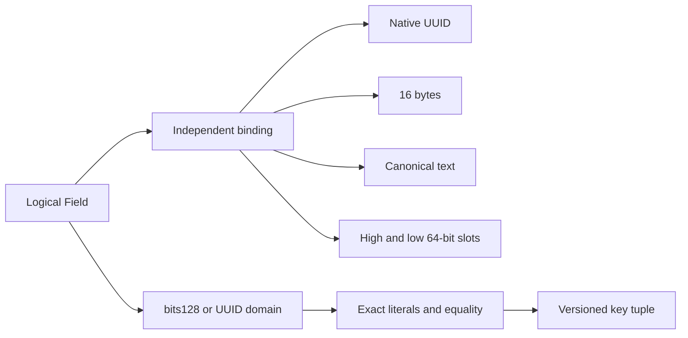

---
ddx:
  id: SD-005
  type: solution-design
  activity: design
  status: draft
  authoring:
    home: repo
  links:
    - id: FEAT-005
      kind: informed_by
    - id: umf.prd
      kind: informed_by
    - id: umf.architecture
      kind: references
---

# SD-005: Native 128-bit and UUID values

**Feature:** [FEAT-005 IDEAL-09](../../01-frame/features/FEAT-005-core-ideals.md).
**Authority:** owner direction, 2026-10-15; FR-3/8/20/21/28/39/41.
**Shared interface:** [CONTRACT-076](../contracts/CONTRACT-076-128-bit-uuid.md).
**Status:** implementable design; no runtime/native qualification claimed.

## Scope

Define exact opaque128-bit and UUID values in proposed core0.9.0, preserve
integer128 arithmetic through existing width facets, and separate logical meaning
from independently selected physical carriers. This extends the architecture's
existing core/value/binding/native boundaries; it introduces no hosted service.
Existing0.8.0 behavior and earlier evidence remain scoped to their versions.

The differentiation is a logical UUID that remains usable across heterogeneous
systems while selecting native UUID, compact bytes, canonical text or paired
integers according to a declared target/workload. Storage shape cannot erase
UUID identity or silently change comparison. UMF defines portable meaning and
recipes; Truss/Weft and other consumers execute actual reads/writes and queries.

## Requirements Mapping

| Requirement | Design element | Verification outcome |
| --- | --- | --- |
| IDEAL-09 / FR-3 | Separate bits128/UUID ideals, reuse integerWidth128 | All bits admitted; exact signed/unsigned boundary refusals; distinct domain tags |
| FR-8/21 | Exact codecs and independent fidelity obligations | Endian, overflow, malformed pair, ordering and cast counterexamples refuse or residualize |
| FR-20 | Logical identity plus several explicit binding choices | Same logical Field and bits recovered through each selected carrier |
| FR-28 | Separate ideal admission, five-system delivery and equivalence | No schema-only or retained-sidecar proof counted as native enforcement |
| FR-39 | Portable TypeScript implementation; Bun and Chromium | Public-bundle parity, zero host globals or external requests |
| FR-41 | Literals, Field validation, keys, inspection and selection | Consumers use structured metadata and exact values without parsing docs |
| Durable artifacts / bounded processing concerns | Versioned migration and copied exact sources | Earlier envelopes recover; new meanings survive rollback separately; over-limit refusal |

## Solution Approaches

| Approach | Benefit | Cost / decision |
| --- | --- | --- |
| UUID as string format only | Minimal schema changes; broad transport compatibility | Cannot express intrinsic128-bit identity/equality or layout-independent carrier choice; rejected as governing model |
| UUID as integer128 | Compact arithmetic substrate | Conflates identifier and numeric meaning, signedness and native ordering; rejected as logical model |
| UUID as binary with exact-length facet only | Lossless bytes using existing family | Does not expose UUID interpretation to metadata consumers; retain as a physical carrier |
| Separate bits128/UUID families, integer128 facets, explicit physical carriers | Intrinsic width, logical identity, exact portable values and target-specific optimization | Requires a new core/literal/key profile and qualified binding work; selected |

Two new families are justified: opaque bits support arbitrary128-bit identifiers,
hashes or values without falsely asserting UUID intent; UUID supplies stable
identifier semantics over those bits. Integer128 already has a useful ideal.
Neither a new host primitive nor a mandatory two-word in-memory representation
is needed. Pure codecs may use bigint internally; JSON-safe public values use
exact text. The ordinary envelope's numeric policy remains unchanged.

## Domain Model

One logical UUID remains one Field and one key component even when physically
split. Equality uses every bit; physical order and enforcement remain separate
obligations. UUIDs preserve unknown/reserved layout bits. Generation validation,
UUID version restrictions and time semantics require distinct future contracts.
Native payloads and unknown content remain attached after classification.

## System Decomposition

The [architecture module boundary](../architecture.md#proposed-128-bit-and-uuid-module-boundaries)
is authoritative. Shared signatures, shapes, errors and versions belong only to
CONTRACT-076.

| Component | Existing state → change | Ownership / dependency rule |
| --- | --- | --- |
| Portable value codecs | Exact numeric tokens exist → add `src/model/bit128.ts` and `uuid.ts` | Own value conversion, no adapter/document/registry imports; reuse portable error types |
| Core metadata and validation | Nine families → version-dispatched0.9 family/literal/constraint checks | `types.ts`, `scalar-type.ts`, `schema-literals.ts`, `schema-properties.ts`, `validation/`; import codecs, preserve unknowns |
| Schema resources | Existing0.8 schema/property/selection profiles → new0.9 schemas and result profiles | Add distinct resources under `spec/core/`; never relabel prior schema IDs |
| Migration | Existing version transitions → explicit0.8→0.9 collision-aware transition | New `src/model/bit128-transition.ts`; full old/later envelope retention and exact replacement mapping |
| Keys | Current-only tuple operationv3/v1 → operationv4 with explicit profile | `key-tuple.ts`, `keys.ts`, `validation/keys.ts`; existing profile bytes immutable |
| Physical binding | One native column/embedded slot → new explicit scalar carrier profile | `src/extensions/binding/`, `spec/extensions/binding/`; bind logical identity and enumerate every slot |
| Native integrations | Native UUID preservation is uneven → useful qualified classify/project recipes | `src/core-ideals/`, adapters and projections; no inference from display names |
| Public integration | Existing exports/build/resource registration → dispatch new profiles | `src/index.ts` owns construction/exports; update schema registry/package resources together |
| Evidence tools | Existing oracle/browser harnesses → new128-bit matrix and carrier comparisons | `scripts/`, `native/`, fixtures and tests; excluded from portable imports |

No portable codec imports Field validation: coordinators call codecs, then apply
context. This avoids a model/validator dependency cycle. Native transport codecs
remain consumer-owned, even when they call these shared recipes. Old generators,
security evaluators and action profiles must explicitly refuse the new families
until separately admitted; adding a core family cannot silently widen execution.

### Native target design matrix

This is a qualification plan, not a claim that these mappings currently pass.
Native versions below are evidence targets drawn from existing project profiles;
each fresh receipt must record its actual runtime and supported subset.

| Target | UUID carrier design | Required qualification / permanent counterexample |
| --- | --- | --- |
| PostgreSQL17 | Native uuid; explicit bytea/text or two bigint alternatives | Native syntax may be broader; full-token core parsing precedes target casts. Byte length, pair availability/key atomicity, driver order and comparison must be measured. |
| SQL Server2022 | uniqueidentifier; explicit binary(16), text or two bigint alternatives | Native UUID order differs from bit order; casts may truncate long strings. COM/driver byte representations require named codec evidence, not a general byte reversal. |
| Apache Avro1.12.0 | uuid logical annotation on string or fixed16; explicit two-long record alternative | Declaration, writer and reader differ. Existing avsc/fastavro evidence is not proof of every logical type; scope each runtime. Two-long nesting is a schema change with explicit path bindings. |
| Apache Parquet format2.11.0 | UUID annotation on FIXED_LEN_BYTE_ARRAY16; explicit two INT64 leaves alternative | Separate annotation validity, actual writer/reader and sort behavior. No UUID inference from unannotated bytes or two leaves. |
| TableSpec pinned model/Spark4.0.1 | Explicit canonical string fallback first; pair only if target accepts two exact64-bit slots | Existing INTEGER mapping has a signed32-bit Spark carrier in its qualified profile. Do not coerce64-bit halves into it or invent a UUID/LONG type. Unsupported pair blocks while text remains useful with declared residuals. |

Binding words refer to native physical slots; Avro/Parquet adapters resolve those
slots to exact record/leaf paths under their existing native location rules. A
new target/path capability needs a separately versioned native binding, not path
strings interpreted as executable expressions. Container mapping is separate.

Standards checked2026-10-15: [PostgreSQL17 UUID](https://www.postgresql.org/docs/17/datatype-uuid.html),
[Microsoft uniqueidentifier](https://learn.microsoft.com/en-us/sql/t-sql/data-types/uniqueidentifier-transact-sql?view=sql-server-ver17),
[Avro1.12.0 UUID](https://avro.apache.org/docs/1.12.0/specification/#uuid),
[Parquet2.11.0 logical types](https://github.com/apache/parquet-format/blob/apache-parquet-format-2.11.0/LogicalTypes.md).
Those sources establish target declarations and hazards, not tested UMF support.

### Performance and physical choice

Two64-bit slots may match an engine's vectors, arithmetic and index capabilities;
they may also increase join/index width or complicate updates. Canonical text may
compress well; native UUID may have a better driver or index implementation.
Therefore neither sixteen-byte payload size nor schema validity proves optimality.

An optional benchmark compares explicit carriers over the same retained corpus,
engine/version, schema, constraints, codecs and hardware. Record actual stored
and index bytes, compression, ingest/update cost, equality lookup, joins, scans,
ordering and client conversion separately. Include random and time-local UUID
populations, nullable pairs, warm/cold runs and repeated trials. Require exact
result identity and negative controls before accepting a speed result. Consumer
optimization may choose a qualified carrier from this evidence; UMF never changes
an authored binding automatically. No numerical SLA is assumed.

## Traceability and Testing

These are required implementation verification allocations, not executed evidence.
Proposed harness paths below must be introduced with implementation; no nonexistent
command is presented as currently passing.

| Obligation | Planned evidence | Pass condition |
| --- | --- | --- |
| Full-bit bijection / FR-3/8 | `tests/bit128.test.ts`, independent Python integer/struct oracle in `scripts/bit128-oracle.py` | Inverse equations for bytes, signed/unsigned words and128-bit integers; zero, all ones, every single bit and mixed high-bit boundaries; seeded broad corpus |
| UUID equality / FR-41 | `tests/uuid.test.ts`, pinned RFC9562 vectors plus nonstandard/reserved layouts | Original spelling preserved, case-equivalent values equal, each changed bit unequal; Nil/Max accepted; malformed syntax rejected |
| Field semantics | `tests/core-uuid.test.ts` | Author/inspect/select, container item references, examples/defaults/allowed values, duplicate equality, unrelated unknown survival and relevant unknown refusal |
| Key invariants | `tests/core-uuid-key.test.ts` and independent byte framing oracle | Contract golden vectors, mixed domain tuples, signed integer128 values, equal iff equal bytes within one declared domain/context; malformed framing and v1 refusal |
| Binding integrity / FR-20/21 | `tests/binding-uuid.test.ts` | Slot overlap, wrong source, stale mapping, partial pair, null ambiguity, signed ordering and unknown encodings refuse or report as specified |
| Migration / FR-21/36 | `tests/core-uuid-transition.test.ts` | Explicit collision handling, original exact recovery, new meaning retained separately on rollback; no implicit native/string promotion |
| Native semantic behavior / FR-28 | `native/uuid/` and `fixtures/validation/uuid/` | Two useful-system ideal admission followed by all-five delivery; schema + datum + native equality/constraints and both recoveries; disagreements retained |
| Browser boundary / FR-39 | `scripts/uuid-browser.ts` | Public ESM bundle matches Bun outputs/diagnostics for all portable cases; zero external requests/Node/Bun globals; actual Chromium version recorded |
| Regression | Existing typecheck/build/schema audits and versioned-operation suites | No old family interpretation, tuple bytes, native preservation or unknown-content regressions |

The independent oracle must use direct bit arithmetic and standard UUID byte/text
construction, not import UMF helpers or regenerate expectations from their output.
Use exact expected bytes and native results, not source-recovery equality alone.
Inject swapped halves, GUID field-endian swaps, signed ORDER BY, one-half loss,
unsafe number conversions, overlong casts, padding/collation collisions and stale
migration records as controls. Tests must fail when their matching implementation
rule is deliberately broken. Every native carrier must distinguish authored
writes, stored values and broader external writes.

Boundary verification uses existing `bun run typecheck`, `bun run build` and
`bun run test:schemas`. The new browser harness must add an import-closure check
for forbidden host APIs; test it by injecting a forbidden import before trusting
the check. Standard build success alone is not a source-boundary proof.

### Readiness and delivery gates

The design fixes semantic domains, exact shared interfaces, migration policy,
physical layout choices and verification obligations. No unresolved product
choice blocks implementation. Native subset capabilities and performance remain
explicit empirical unknowns with bounded qualification tasks; failure narrows
that binding's claim or yields residual/refusal, never changes logical meaning.

Core0.9 must not be called accepted until schema/types/validators/authoring/
inspection/selection/literals/keys/migration/export resources and browser evidence
agree. Then admit the ideal using at least two useful qualified priority mappings.
Deliver all five priority bindings under separate evidence gates. Any native
replacement/equivalence or consumer execution adoption requires additional proof.
The schema explorer may render the new type label only after version-dispatched
metadata support; its display cannot establish generation or storage support.

## Concern Alignment

The selected TypeScript/Bun, browser portability, fidelity/partial understanding,
identity/composition, reproducibility, bounded input, diagnostics and durable
adoption concerns apply. [ADR-002](../adr/ADR-002-bun-development-runtime.md)
continues to govern the runtime split. No formal-methods concern is selected in
the current concern inventory. The finite conversion equations support algebraic
review plus independent and property-based executable checks; no model-checker
or unbounded proof result is claimed.

Diagnostics retain paths, code, target/profile and failed obligation. Raw UUIDs
may be sensitive identifiers; library errors need not echo values. Full source
recovery artifacts require consumer-controlled custody. UUIDs are neither secrets
nor authorization tokens by virtue of this type; no entropy source or network
lookup is needed. Fixed-size conversion is bounded; general integer token
conversion inherits existing expansion limits.

## Migration and Rollback

Use CONTRACT-076's new version profiles and collision-aware source-retaining
migration. Update every family switch and literal/key consumer before advertising
0.9; unsupported generators/security/action domains must refuse. Physical database
changes and key-index rebuilds are consumer migrations, with old carrier/value
custody and explicit cutover/rollback protocols. A metadata rollback cannot undo
committed native writes or reinterpret persisted v2 keys.

## Risks and constraints

| Risk | Consequence | Required mitigation |
| --- | --- | --- |
| Sign or GUID byte-order confusion | Stable but wrong identities | Mixed high-bit golden vectors and native driver/byte oracle |
| Paired slots used independently | Torn values, false uniqueness/joins | Full-slot binding inventory and actual atomicity/key/relationship evidence |
| Canonical strings overstate enforcement | Wrong equality after external writes | Separate write/stored profiles, strict full-token decode, constraint/collation probes |
| New families leak into old profiles | Silent adoption or execution widening | Version-scoped schemas, explicit migration collisions and exhaustive consumer refusal controls |
| v2 key namespace mixed with v1 | Broken aliases and relationship identity | Explicit codec choice, separate namespaces and consumer-controlled rebuild |
| Native qualification lags | Overstated compatibility | Publish useful text fallbacks with residuals; keep five-system gates open |

No new runtime dependency, mandatory storage layout, UUID generator or cross-repo
implementation is required to accept this design. Native evidence and optional
benchmarks determine supported subsets and optimal layouts later.
