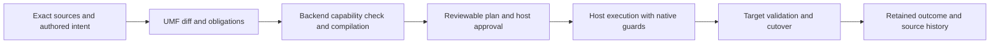

---
ddx:
  id: SD-007
  type: solution-design
  activity: design
  status: draft
  authoring:
    home: repo
  links:
    - id: FEAT-007
      kind: informed_by
    - id: US-051
      kind: informed_by
    - id: umf.architecture
      kind: references
    - id: CONTRACT-046
      kind: references
    - id: CONTRACT-049
      kind: references
    - id: CONTRACT-081
      kind: references
---

# SD-007: Schema migration planning and backend execution

## Scope

**Feature:** FEAT-007 COMP-06–11; FR-18/19; US-051-AC11–16.
**Status:** solution design for the owner's 2026-10-21 field migration request;
exact profile/API contracts and native qualification remain separate gates.
Support covers adding Fields, making them required with defaults or backfills,
dropping Fields and changing their types. Full support means each operation has
defined semantics, executable qualified backend profiles and explicit refusal
elsewhere; it does not imply every backend can perform every operation online.

Governing boundaries are NFR-50, ADR-002, CONTRACT-040/049, the read-only
CONTRACT-046 comparison, and CONTRACT-081 table lifecycle. Core version migration
is separate from evolving a user's schema. CONTRACT-058 retains its historical
bounded profile; new work must not relabel it as general migration support.

## Requirements Mapping

| Requirement | Capability and owner | Verification |
| --- | --- | --- |
| COMP-06 / AC11 | Portable identity-based diff and explicit add intent; adapter absence mapping | Exact-source optional date addition; unrelated/unknown content retained |
| COMP-07 / AC12 | Separate default/backfill intent; host validation and write protection | Existing and concurrent data satisfy required target |
| COMP-08 / AC14 | Portable conversion obligations; backend-specific lowering | Valid, invalid, boundary and lossy conversion cases |
| COMP-09 / AC13 | Dependency inventory and explicit retirement/purge decision | Dangling key, policy and client dependency rejection |
| COMP-10 / AC16 | Versioned intent, capability negotiation, source-bound plans and receipts | Same intent across distinct backend capabilities |
| COMP-11 / AC15 | Host execution states, resumability and recovery | Faults, races, drift and uncertain commit outcomes |

NFR-1/2/3 require retained before/after meaning and explicit loss. NFR-11/12
require deterministic offline planning. NFR-15–19 require bounded metadata work
and untrusted-input admission. NFR-20/21 require version/subset evidence.
NFR-50 separates the portable library from storage execution.

## Solution Approaches

**Selected proposal: portable declarative intent with backend compilation and
host execution.** One logical change can produce transactional table alterations,
a staged rewrite, a graph-engine transition or a new immutable publication.
Shared obligations stay inspectable and independently implementable. The cost is
an explicit capability protocol and backend-specific conformance work.

**Alternative: portable SQL migrations.** Convenient for one relational target,
but SQL cannot define graph publication, file rewrites or absence semantics across
targets. It also conflates native casts with meaning-preserving conversions.

**Alternative: backend-owned opaque migration scripts only.** Flexible execution,
but UMF cannot inspect dependencies, compare losses or verify that the result
discharges the authored change. Explicit native steps remain an escape hatch
with pinned artifacts, declared effects and postconditions; they cannot receive
portable semantic-preservation claims.

Architecture impact: the portable library describes and compiles plans; optional
UMF-distributed host components execute under independently supplied authority.
This follows the existing CONTRACT-081 split and preserves NFR-50.

## Domain Model

| Concept | Meaning |
| --- | --- |
| Source pair | Independently retained exact old/new sources, logical IDs and dependency closure |
| Change intent | Authored operation, target IDs, historical fill/conversion, future-write behavior and loss policy |
| Capability profile | Exact backend/version/subset, atomic/staged/publication support, limits and evidence |
| Plan | Ordered dependency graph of steps, input/output states, checks, write policy, recovery and artifact digests |
| Approval | Host authorization bound to the concrete plan, target and permitted destructive effects |
| Outcome | Authenticated execution state and validation evidence bound to source, plan and target generation |

Stable IDs identify lineage, not compatibility. A newly added ID cannot inherit
an old Field's values through name similarity. Removed IDs cannot be reused to
reinterpret retained data. Rename and identity remapping need separate explicit
operations. Unknown extension content survives; unknown dependencies affecting a
change block a complete plan. External dependencies require a host inventory and
declared coverage, because UMF cannot discover all consumers of a schema.

## System Decomposition

| Responsibility | UMF portable library | Backend adapter/compiler | Execution host and storage backend |
| --- | --- | --- | --- |
| Describe meaning | Diff known assertions; validate intent and exact literals; expose unknowns | Interpret declared native binding and capabilities | Supply actual installation and dependency inventory |
| Build a plan | Order obligations; retain sources; explain losses and recovery | Lower to native schema/data operations; identify locks, scans and rewrites | Select operational limits, rollout and credentials; approve target-bound plan |
| Backfill/conversion | Define input/output types, versioned transform reference and failure policy | Compile supported expressions or require explicit native/host step | Read/transform/write rows or files; checkpoint, retry and enforce limits |
| Validate | Supply portable target value rules and evidence requirements | Specify native constraints and complete checks | Validate actual data; prevent races; retain evidence |
| Activate/recover | Verify receipt structure and correspondence to retained inputs | Define qualified transition and recovery mechanisms | Fence writers, commit/publish, update history, resolve unknown outcomes |

The portable library never opens connections, scans user datasets, runs embedded
SQL or evaluates arbitrary callbacks from schema metadata. A host transform is a
separately trusted, versioned implementation. Its code/artifact identity, required
inputs and declared determinism enter the approved plan. External side effects
are outside the first backfill profile. Weft remains the lowering owner where
the table profile uses it; do not create a competing general query engine.

### Add and require

An optional birthday addition declares how old absence is represented: an absent
property, a native null, or an explicitly approved read-time interpretation.
Adding the definition alone does not assert that data was physically rewritten.

A required addition and an optional-to-required change both require a plan for
existing missing/null values. Choose fail-if-any, an explicit typed literal, or
a versioned transformation from identified source fields. The default target
set is missing/null values under the selected binding; overwriting present values
requires a separate explicit choice. A backfill must satisfy the complete target
type, facets, keys, references and applicable policies, not only presence.

Logical default resolution, native defaults on future writes, and one-time
historical backfill are independent. A future insert default does not cover
explicit null, later updates or old rows unless the native profile proves it.
Changing/removing a future default does not retroactively change filled rows.
A birthday sentinel is an author decision; UMF must not invent a date.

Protect concurrent writes before the backfill starts. The backend can use a
qualified atomic operation, constrained writes, coordinated dual writes or a
fenced maintenance window. An online staged plan must specify how inserts,
updates and deletes are reconciled and how old clients behave. Backfill chunks
use stable key/version checks or an equivalent backend mechanism, not offsets
or unconditional updates that overwrite concurrent edits. Final complete
validation and constraint activation/cutover have no unprotected gap. A sample
or preliminary scan cannot discharge the activation check.

### Drop

Separate removal from the current logical view, retirement of writer/client
capabilities, physical column/property deletion, and purge from retained history.
Dependencies include keys, relationships, defaults, computed values, indexes,
checks, partitions, policies, actions, query catalogs and generated clients.
Each relevant dependent change is ordered in the plan or causes refusal.
Unknown dependent semantics cannot be silently dropped with a native cascade.

Default proposal: retire access, retain values for an explicitly selected recovery
window, then physically purge under a separate approved step. No retention period
is assumed. A host may approve immediate purge with explicit irreversible loss.
Backups, archives and immutable publications have separate retention/deletion
policy; dropping a current Field does not claim erasure of historical copies.
Record-schema archives preserve metadata, not deleted instance values.

### Change type

Require either a version-qualified rule proving preservation for the actual
source domain and binding, or an explicit conversion with defined failure/loss
policy. Distinguish target validity from semantic equivalence and reversibility.
Logical integer widening can still require a physical rewrite or lock. A date
to timestamp conversion needs an authored time and timezone rule; string to date
needs an authored format and invalid-value policy. Do not infer either from host
locale, timezone or permissive native cast behavior.

Default failure policy is to reject and leave the current schema active.
Explicit reject/quarantine or lossy conversion must state row disposition,
access control and counts; retained invalid rows cannot silently vanish from a
claimed complete migration. Round-trip proof or retained original values is
needed for reversible conversion; an inverse cast is insufficient.
Use an in-place native operation only when qualified. Otherwise create a shadow
representation, copy/convert, reconcile concurrent changes, validate and switch
the binding/client generation together. Retire the old representation later.

### Lifecycle and recovery

The plan covers prepare, protect writes, populate/convert, validate, activate and
retire/purge phases; a backend may combine phases when its evidence permits.
Preparation is not activation. Plans bind exact source, binding, capabilities,
transform artifacts and predecessor generation; hosts recheck drift and approval
at execution. Schema/content digests establish correspondence, not authorization. Plan and
outcome verifiers require independently retained expected sources and target
identity; accepting a receipt's self-reported hashes is insufficient. Host evidence
records the protected data scope/generation and validation coverage. Portable
verification checks provenance and correspondence, not unseen row correctness.

Atomic execution rolls back only effects the backend actually makes atomic.
Staged execution records durable checkpoints, step idempotency and forward
recovery. Commit-response loss triggers outcome lookup before retry. Validation
failure never publishes the target generation. Atomic failure restores the old
state; committed staged effects may require forward repair while ordinary clients
remain fenced. Retaining the old generation identifier does not prove that its
physical schema is still usable. Partially staged state is inaccessible to
ordinary clients. The host prevents competing migrators and coordinates
active transactions, old generated clients, prepared catalogs and cursors.

After cutover, application writes can make reversal unsafe. Recovery must state
whether it uses retained values, a verified backup, reverse transformation or a
forward repair. Never claim that restoring old schema metadata restores data.
Cross-store changes use explicit coordination and recovery; no distributed
transaction or single atomic publication is assumed.

## Traceability

### First native release acceptance

The U1/U2 implementation may deliver a bounded PostgreSQL profile with explicit
maintenance/fencing semantics. Online chunked backfills, arbitrary transformations,
retirement windows, shadow type rewrites and additional backends remain later
capabilities. This does not weaken the full field-lifecycle requirements.
The accepted inventory must mark each requirement as qualified, explicitly refused,
or remaining work; a bounded release must not be called full migration support.

The first native release must satisfy these design checks for every claimed
supported operation:

- An appended required Field is populated explicitly before native requiredness
  and future default activation. For an existing optional Field, fail-if-null
  tightening and historical-fill-then-tighten are distinct cases. A profile that
  can only fill appended columns must refuse the latter and retain that gap.
- Native presence checks and activation occur under qualified protection from
  writes; direct authorized SQL and old clients cannot race a naked preflight
  scan. Maintenance-mode blocking is valid and must be documented honestly.
- A drop's review surface names the deleted logical/native object and stored
  value loss. Approval explicitly covers immediate irreversibility or a supplied
  recovery policy. PostgreSQL's dependency restriction alone does not establish
  that local indexes/constraints are preserved; typed dependency analysis and
  explicit companion changes are required.
- Known dependencies resolve by stable typed identities. SQL name matching can
  supplement diagnostics but cannot prove complete dependencies. Include inbound
  cross-table references, declared operations and policy predicates. Unknown or
  external dependency coverage is declared; unresolved relevant meaning refuses.
- Finite physical widening rules also check logical type, facets, defaults,
  allowed values and unknown extensions. A reviewed marker for physical widening
  cannot authorize an unrelated semantic narrowing. Combined operations either
  have a proved dependency/name order or refuse explicitly.
- Every committed phase binds effect completion and progress atomically where
  supported. Nontransactional effects have exact reconciliation rules. Native
  generation admission stays fenced through final verified publication; schema
  history alone never constitutes data rollback evidence.
- Immutable historical plans verify under their original version's rules.
  Stricter successor review requirements must not invalidate recorded history.
  Verification of an old artifact is separate from permission to execute new
  effects; current host admission still selects its accepted execution profile
  and requires fresh applicable authorization.

Code and native acceptance remain owned by **Plan UMF and Weft Praxis asks**.
This design review checks these obligations against its actual contract, diff and
evidence before treating an operation as supported.

Native reference: [PostgreSQL 18 ALTER TABLE](https://www.postgresql.org/docs/18/sql-altertable.html)
defines automatic removal of local indexes/constraints on column drop, native
requiredness validation, default changes and type conversion. These native rules
inform adapter obligations; they do not establish portable semantic preservation.

The requirements table allocates every new criterion to components and tests.
CONTRACT-046 remains the read-only comparator. CONTRACT-081 owns the first native
table execution profile. The [build plan](../../04-build/schema-migration-plan.md)
requires a migration-intent/plan/outcome contract, story technical design and
AC-level test allocation before implementation. Existing U1/U2 work in the chat
**Plan UMF and Weft Praxis asks** owns the native CONTRACT-081/TD-085/STP-085
implementation. Reuse its interfaces and evidence, assess them against this design,
and create additional contracts/technical designs only for uncovered requirements.
The owner assigns that chat code ownership and this chat design review.
Exact public shapes, capability
limits and diagnostic codes are intentionally not frozen by this design.

## Existing optional-field fill before requiredness

This successor design closes MIG-G01 within the existing single-document,
existing-table maintenance model. It implements US-051-AC12/15/16 through
CONTRACT-081 and TD-085/STP-085; it does not require the general transformation
or online reconciliation designs. Code remains owned by **Plan UMF and Weft
Praxis asks**. Version numbers are unassigned until the current release closes.

### Selected semantics

For `Person(name, birthday?: date)` becoming `Person(name, birthday: date)`,
the administrator explicitly selects a historical fill, for example the authored
date literal `2000-01-01`. This is a domain decision about missing birthdays;
UMF must never invent a birthday. The intent selects only native NULL values.
An existing birthday remains byte/value-equivalent under the qualified codec.
SQL storage maps this profile's optional value to NULL; there is no separate
stored missing-value state. Other absence mappings require another profile.

The selected operation is an original authored command in the exact approved
**next-source** module, as in current appended-column fill. It is not a command
looked up by name in an ambient registry or necessarily present in the predecessor.
The command remains a parameter-free, non-batch typed UPDATE with one assignment,
no returning rows, the exact selected Field's `isNull` predicate, and an explicit
existing Weft effect bound. Allowed assignments are a typed non-null literal or
the already qualified transaction-clock expression where the target domain
admits it. An instant clock cannot silently become a date or infer a timezone.
Weft owns data SQL lowering and binding; the portable planner owns selection,
source correspondence and operation/type validation.

The table and Field retain their stable IDs, physical names, logical/native
types, facets, defaults, generated/immutable status and collation. The only
selected Field change is optional-to-required. Generated or immutable targets
refuse. Unrelated source changes still pass existing admission rules; the first
G01 profile refuses selected-field rename, conversion, removal, future-default
change and dependent-object change in the same plan. Broader combinations require
separate qualification. Duplicate fills, nullable fill values, excess bounds,
wrong predicates, extra assignments, missing markers and unused selections refuse
before effect dispatch. Native constraints remain active and can reject an
otherwise typed fill, including uniqueness, checks and foreign keys.

Historical fill, logical default and future-write native default remain separate.
Adding a future default neither selects a fill nor proves old rows valid. Existing
future-default semantics remain unchanged in G01. A later omitted birthday still
fails if the target has no future default; explicit NULL fails requiredness even
when a future default exists. A literal fill is already possible without adding
general default lifecycle support (MIG-G03).

### Ordering and recovery

Reuse the existing durable phase runner and ledger, with a successor compiler
grouping rule: the selected fill and its reviewed `tighten-not-null` step occupy
one required transaction phase. After target/source/authority admission and
migration fencing, obtain the existing native exclusive table locks, revalidate
the phase boundary, run the approved null-only UPDATE, then enforce NOT NULL
before releasing those locks. Restore and verify row-level security before commit.
The data effects, requiredness, bounded count and progress receipt commit together.
Native enforcement checks the actual complete table; a cached count or sample
cannot substitute. Verify the final native catalog, privileges and source
correspondence before publishing the new generation and enabling its clients.

Application admission remains fenced between phases. The current metadata-head
grant fence protects generated-client ingress; it does not establish persistent
direct-table writer exclusion. Consequently no commit barrier, concurrent-index
step or other lock release may split the selected fill/tighten pair. Direct
writers wait for the phase's locks, then encounter enforced requiredness. Test
held transactions and writers scheduled immediately after fill. A future split
pair requires a separately qualified persistent native write guard. Privileged
administrator interference remains subject to the existing trusted-host boundary
and resumed native drift checks.

An error, bound excess, failed NOT NULL enforcement or cancellation before a
confirmed paired-phase commit rolls back that phase's data, requiredness and
progress. Once the pair commits, its values and constraint remain even if a later
phase or publication fails. The installation stays fenced until exact resume or
separately authorized forward repair. There is no promise of whole-plan data
rollback. A lost commit response is resolved from authenticated native progress
and witnesses before retry; committed fill is never dispatched again.
Transaction-clock values are fixed by the successful paired transaction. A known
aborted attempt may obtain another transaction time on retry; an unresolved
attempt cannot be retried speculatively. No per-row clock values enter receipts.

### Profile and acceptance boundary

Use a distinct successor options/plan capability for existing-column fill.
Retain exact historical verification/replay of 0.1/0.2 artifacts and their old
appended-column semantics. New execution requires current profile admission;
historical verification alone grants no effects. Reuse the existing backfill
selection structure where sufficient; any new member must have a closed shape,
bound and digest coverage. Do not introduce a second transformation format,
phase journal or core envelope revision.

Before code, allocate exact wire shapes, diagnostic codes, compiler/host version
admission and boundary-check commands in CONTRACT-081/TD-085, and primary fixture
ownership in STP-085 with `@covers US-051-AC12`, `AC15` and `AC16`. If one reviewed
artifact amendment is insufficient, add only the missing contract surface.
The [build plan](../../04-build/schema-migration-plan.md#remaining-gap-delivery-order)
defines the G01 implementation gates and subsequent residual sequence. Existing
fail-if-any-null tightening and appended-column fill retain regression coverage.

## MIG-G02 — typed same-row backfills (selected 2026-10-23)

### Ownership and version boundary

The human selected all remaining MIG-G02–G11 work through review, verification
and release, with G02 first. This section fixes the G02 design; it does not claim
implemented support. The implementation session owns product code and integrated
CONTRACT-081/TD-085/STP-085 amendments. The design session independently reviews
those interfaces, candidate code and installed native behavior.

UMF owns the closed expression description, stable references, source/target
compatibility, effect/phase intent, canonical identity and refusal diagnostics.
Weft owns expression admission against native types, parameter binding, all SQL
and the exact-value guard. The host owns approved installation authority, native
catalog closure, writer exclusion, execution limits, atomic progress and outcome
recovery. No portable library connects to storage or evaluates application code.
No Praxis implementation changes belong to this workstream.

Allocate `umf.table-operation/0.2` for this closed UPDATE capability and
`umf.table-migration-options/0.4` / `umf.table-migration/0.4` for its migration
profile. Allocate `weft.table-operation/0.2` for guarded compiled programs. Existing
0.1 operation and 0.1–0.3 migration artifacts retain their exact grammar, digest
and replay semantics. Source-module, approval, execution-reference and ledger
admission must explicitly distinguish the successor: unchanged storage layout is
not permission to reinterpret old records. CONTRACT-081 must fix each affected
version and wire member before code. An unchanged wrapper is acceptable only
with an explicit closed version dispatch and rejection by incompatible hosts.
The UMF opt-in Rust migration compiler must refuse 0.4 before effects unless it
receives its own implementation and qualification. Weft's Rust lowering does not
establish UMF Rust migration support.

### Closed value algebra

A successor assignment adds `{kind: "rowExpression", expression: RowExpression}`.
`RowExpression` has exactly these tagged forms (all objects closed):

| Form | Members besides `op` | Meaning |
| --- | --- | --- |
| `field` | `field: TableRef` | Stored value of an unchanged input Field in this row |
| `literal` | `value: CoreLiteral` | Exact typed core literal, including explicit NULL |
| `coalesce` | `args: RowExpression[]` | First non-NULL argument, left to right |
| `concat` | `args: RowExpression[]` | Text concatenation; any NULL operand yields NULL |
| `add`, `subtract`, `multiply` | `left`, `right: RowExpression` | Exact finite arithmetic |
| `conditional` | `when: TableOperationPredicate`, `then`, `else: RowExpression` | True selects then; false or unknown selects else |

Coalesce/concat have 2–32 operands. Bound the entire expression, including
conditional predicates, to depth 16 and 256 nodes; repeated references count
again. Unknown operators/members, malformed tokens, cyclic in-memory objects,
nonfinite literals and resource excess refuse before SQL. Existing predicate
syntax supplies conditions, not an alternative value-expression language.
Predicates in this capability reference only the same admitted input Fields and
closed literals; parameter, principal and clock predicates are forbidden.

Every referenced input exists with the same stable module/element identity,
stored native/logical type, facets and meaning in both retained sources. Inputs
belong to the target table, are unchanged by this migration, and exclude the
target, generated/volatile values, newly appended siblings and unknown relevant
semantics. No join, subquery, callback, native SQL, ambient principal, clock,
lookup, aggregate, recursion or external effect is permitted inside this algebra.
The exact AST and retained source bytes are digest-covered transform identity;
there is no independently mutable transform registry or host callback package.
Legacy literal/transaction-clock assignments retain their separate qualification.

### Type, NULL and exactness semantics

Field and literal leaves have carrier types. Intermediate typing does not apply
all target refinements to each operand: a separator literal need not satisfy the
final string's enumeration or minimum length. Coalesce and conditional branches
must have compatible carriers. Text/varchar uses exact Unicode text and C
collation; char/bpchar and locale-dependent operations refuse. Date, instant,
UUID and boolean support copy/coalesce/conditional only when source and target
native/logical meanings match exactly. No parsing, timezone conversion or cast
language is implied. Float and mixed text/numeric coercions refuse.

Integer arithmetic and finite decimal arithmetic use an exact numeric evaluation
carrier. Integer-to-decimal promotion is exact and explicit in the type rules;
integer targets require a statically integral result. Decimal inputs require a
known finite native precision and scale with 0 <= scale <= precision. Unbounded
numeric and negative-scale numeric refuse in this profile. Represent each numeric
node conservatively by maximum integral digits I and fractional digits S:
leaves use native/token bounds; add/subtract use I=max(I1,I2)+1 and
S=max(S1,S2); multiply uses I=I1+I2 and S=S1+S2; branch/coalesce uses componentwise
maxima. Every node must satisfy I+S <= 1000. SQL uses unconstrained exact numeric
intermediates, never a typmod cast that rounds an intermediate. Native target
range/precision and all authored refinements remain effective. Native constrained
numeric can still contain NaN: a matched row with a nonfinite value in any
referenced numeric input must abort, even if a conditional branch would not use
it. The Weft full-effects guard checks that input closure plus finite final
numeric output; static typmods alone do not prove finiteness. NULL input is
permitted according to the expression rules. No NaN equality or ordering may
silently select a branch or certify an exact output.

Potential NULL is recorded in static typing. It need not be proved absent to
admit an expression: the selected policy is **abort the entire phase on any NULL
or invalid final result**, never skip, substitute an implicit default, quarantine
or report partial success. A coalesce fallback is an explicit authored choice.
Target NOT NULL, checks, allowed values, length/facets, uniqueness and references
must be enforced before the phase can commit. Unsupported refinements refuse;
ordinary validation warnings cannot stand in for enforcement.

A value satisfying the target constraint can still have lost meaning:
[PostgreSQL 18 numeric assignment can round](https://www.postgresql.org/docs/18/datatype-numeric.html),
and [varchar assignment can discard trailing spaces](https://www.postgresql.org/docs/18/datatype-character.html).
Weft must prove the stored value equals the exact intended result for **every**
matched row. The selected mechanism extends its existing data-modifying CTE:
RETURNING privately compares the stored target to the pure expression evaluated
from unchanged inputs; a full aggregate guard combines exactness/non-NULL with
the existing effect-count guard and raises a statement error on any failure.
Numeric comparison uses exact numeric values; text comparison uses text with C
collation and significant trailing spaces. No private row values or booleans
escape through the public result. Zero matches pass the exactness guard. The
guard must depend on the full effects relation, so pagination or a LIMIT cannot
hide an invalid row. Native errors remain errors. All functions, operators, types and collations use qualified built-in resolution;
ambient search_path must not change meaning. No CTID join or speculative
preflight scan is introduced. Catalog authority excludes effectful triggers,
rules and other unreviewed objects that could invalidate pure reevaluation.
The exact compiled-program guard descriptor and host validation are contract
requirements, not optional SQL hints. An old host must reject a 0.2 program.

### Atomic migration profile

One parameter-free, nonbatch UPDATE assigns one selected target, with exactly
`isNull(target)` as its predicate, no returned row values and maxRows in 1–10000.
Present target values and all input/unrelated values remain unchanged. Application
admission stays fenced; native locks exclude direct writers throughout the phase.

Support two independently tested shapes before calling the selected G02 profile
complete: (a) an existing optional target becomes required without any other
meaning/default change, using the G01 fill/tighten pair; (b) one appended required
target is added nullable, filled, given its independently authored future default
if selected, and constrained in one required transaction. All target validation
and data/DDL/progress commit together. No concurrent index barrier or lock release
may split either shape. If shape (b) needs extra phase grammar, encode it as a
closed correspondence with exact ordered steps; never inherit a split legacy
phase accidentally. Compound unrelated changes and dependent new-field chains
remain refused. Future defaults do not supply existing-row values implicitly.

Known aborted attempts may retry. Unknown commit outcomes must be observed from
authenticated progress/native witnesses before dispatch. Committed work is never
rerun, even though expressions are pure. Failure after this phase commits keeps
the installation fenced for exact resume or separately authorized forward repair;
whole-plan data rollback is not promised. Receipts contain counts, identities and
outcomes, not birthdays, raw rows or rejected samples. Ordinary diagnostics must
sanitize native DETAIL; private host error custody is a separate authority.

### Required independent acceptance

Before code, the implementation owner integrates the exact successor schemas,
program guard descriptor, diagnostic/refusal codes, wrapper/runtime/version
matrix and phase correspondences in CONTRACT-081/TD-085, plus STP-085 cases.
Design review must pass those concrete interfaces before implementation begins.

Native acceptance uses a fresh frozen installed cohort and manually specified
expected rows (high-precision independent decimal calculations where useful),
never the same AST evaluator as the oracle. Include distinct per-row outputs,
copy/coalesce/strict concat/conditional/arithmetic, Unicode and trailing spaces,
zero matches, preserved present/input/unrelated values, and both phase shapes.
Exercise intermediate budget refusals, overflow, NULL, decimal rounding, length,
checks/enumerations, unique/FK failures, row-bound overflow and invalid rows after
valid rows; every failed phase must leave no partial data, DDL or progress.
Held writers, cancellation, faults before/after commit, lost commit responses,
resume without repeat, tampered AST/references/source/approval/program and old
0.1–0.3 verification/replay are mandatory. Bun and real Chromium establish
portable behavior; native PostgreSQL establishes storage effects. Release review
must verify exact dependency wheels/WASM/SDK hashes, supported platforms and fresh
published downloads against the approved candidate. No arbitrary transforms,
online execution, managed consumer acceptance or additional backend qualification
is implied by this finite G02 algebra.

## Concern Alignment

ADR-002 keeps planning browser-compatible TypeScript, tested in Bun and Chromium.
Fidelity, stable identity, bounded processing, reproducibility and qualified
conformance apply to all components. Existing Python host boundary controls apply
to execution. Birthdays and backfill rejects may be personal data: schemas and
default literals are inspectable metadata; row values/reject samples require host
access controls and must not enter portable receipts or ordinary diagnostics.

## Constraints & Assumptions

Proposed rollout: current-core single-document PostgreSQL first, using retained
source bytes and existing deployment generations. US-050/CONTRACT-045 remain
prerequisites for cross-document migration; no implicit core members are added.
Truss owns mutable graph admission/journals; Ashlar owns new immutable publications
and their source revision custody; table/file formats own metadata commits and
rewrites. They qualify independently against the shared intent requirements.

Open decisions before the relevant implementation slice: exact capability and
conversion grammar; trusted transform packaging; scan/chunk resource bounds;
retention duration and purge authority; managed target restrictions; backend
rollout after PostgreSQL. General key/relationship migrations beyond dependencies
of these four field operations require later scope. Required dependency changes
must be explicit supported companion steps or block the field migration.

## Risks

| Risk | Impact | Mitigation |
| --- | --- | --- |
| Unknown consumers or extension dependencies | Broken readers/security | State inventory coverage; refuse relevant unresolved meaning; explicit client cutover |
| Concurrent writes invalidate checks | Invalid active target | Protect writes throughout populate/validate/activate; race tests |
| Native cast changes meaning | Silent loss | Exact conversion semantics, target checks, approved loss and retained originals |
| Staged interruption or response loss | Duplicate effects or inconsistent activation | Durable checkpoints, outcome lookup, fault injection |
| Drop or post-cutover writes defeat reversal | Irrecoverable values | Explicit retention/backup and honest irreversible steps |
