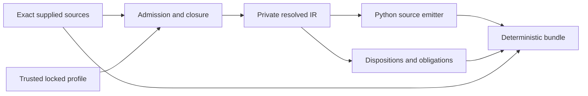

---
ddx:
  id: SD-028
  type: solution-design
  activity: design
  status: draft
  authoring:
    home: repo
  links:
    - id: FEAT-028
      kind: informed_by
    - id: ADR-004
      kind: informed_by
    - id: umf.architecture
      kind: informed_by
---

# SD-028: Python model generation

**Feature:** [[FEAT-028]]. **Contracts:** CONTRACT-067/068.

## Scope

Compile exact local core 0.8.0 selections to typed Python source and retained
reports. The logical schema and physical bindings are distinct inputs; DDD is
not a prerequisite. CONTRACT-051 document access remains unchanged.

## Requirements Mapping

| Requirement | Design element | Verification owner |
| --- | --- | --- |
| PY-01/04 | Admission, dependency closure and selected-assertion census | US-080/STP-080 |
| PY-03/05/06 | Literal renderer, deterministic bundle, isolated host writer | US-080/STP-080 |
| PY-02/03 | Separate model variants, UNSET and exact codecs | US-081/STP-081 |
| NFR fidelity/portability/bounds | Retained source, explicit refusal, no host globals | Both STPs; TP-001 |

## Solution Approaches

Select semantic resolution followed by a private typed intermediate representation
(IR) and deterministic emitters. The IR holds resolved references, exact value
domains, presence/default origins, ordered identities, binding choices, provenance
and undischarged obligations. It never discards source content or becomes a new
UMF authority. Reuse public semantic APIs; unsupported API coverage is an explicit
implementation dependency, not permission to reinterpret labels.

Runtime `create_model` alone cannot expose the desired static symbols. A direct
JSON-Schema-only converter cannot carry the full binding/identity boundary.
One merged ORM/DTO class confuses read/create/patch presence and engine behavior.
ADR-004 records the design-time decision; architecture owns module boundaries.

## Domain Model

Literal schema defaults, server defaults and optional presence remain separate
through resolution. A representation can be exact while enforcement remains a
host obligation. Unknown relevant meaning blocks generation in both modes.

## System Decomposition

Admission/IR and bundle/writer composition belong to TD-080; Python variants and
codecs belong to TD-081. The public compiler facade is the construction point;
the host writes returned files without interpreting their semantics. Public
target renderers consume resolved data and do not reach into admission internals.

## Technology Rationale

Use ADR-002 TypeScript/Bun with real Chromium parity. Generate Python source for
Pydantic 2 with exact dependency pins established by the profile spike. Generated
helpers live inside the generated package. No runtime `umf` import is required.

## Traceability

STP-080 owns US-080 acceptance tests; STP-081 owns US-081 tests. The build gate
requires generated-code static positive and negative cases, Python native value
tests, and byte-identical Bun/browser outputs. Draft plans are not passing evidence.

## Concern Alignment

Apply existing fidelity, exact identity, bounded processing and runtime isolation
concerns plus scoped compiler modularity. No UI/auth/service slots apply. All
diagnostic reports are local files; no OTel integration is claimed.

## Constraints & Assumptions

The initial supported subset is deliberately finite and local; cross-document
US-050 is not required for this subset. Adding it requires a separately adopted
reference profile. Exact dependency locks and recursive-model support remain
qualification decisions under the implementation spike.

## Risks

| Risk | Impact | Mitigation |
| --- | --- | --- |
| Existing advanced semantic APIs are insufficient | Incorrect generated validation | Resolve gaps in UMF with contract tests before admitting profile |
| Sentinel/default/coercion behavior differs by Pydantic version | Presence loss | Python-value boundary and negative examples under exact lock |
| Frozen model contains mutable children | Stale validation | Revalidate at every generated codec boundary |
| Generated bundle overwrites user work | Lost source | Manifest ownership and atomic selection controls |
