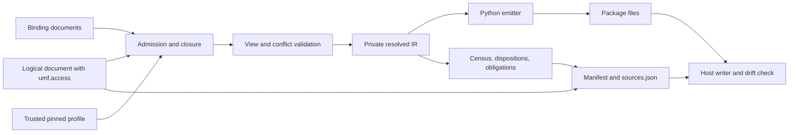

---
ddx:
  id: SD-028
  type: solution-design
  activity: design
  status: draft
  authoring:
    home: repo
  links:
    - id: FEAT-028
      kind: informed_by
    - id: ADR-004
      kind: informed_by
    - id: umf.architecture
      kind: informed_by
---

# SD-028: Typed model generation

**Feature:** [[FEAT-028]]. **Decision:** [ADR-004](../adr/ADR-004-typed-data-access-sdk.md).
**Contracts:** [CONTRACT-067](../contracts/CONTRACT-067-access-sdk-generator.md),
[CONTRACT-068](../contracts/CONTRACT-068-generated-python-types.md),
[CONTRACT-070](../contracts/CONTRACT-070-access-extension.md).

## Scope

Stage one of the SDK build. Take exact local core 0.8.0 documents that carry
`umf.access` 0.1.0, plus the CONTRACT-042 binding documents their ColumnSets
name, and produce a checked-in Python package with a manifest. The package holds
models, Key DTOs, typed column and search-index expressions, codecs and action
types. No SQL is produced and no target platform is chosen at this stage.
CONTRACT-051 document access is unchanged.

## Requirements Mapping

| Requirement | Design element | Verification owner |
| --- | --- | --- |
| TM-01 | `umf.access` validation: coverage, conflict table, native-type compatibility | US-080 / STP-080 |
| TM-02 | Admission, closure, trusted profile pin with `codeSha256`, assertion census | US-080 / STP-080 |
| TM-03 | Python emitter: strict frozen models, `MISSING` presence, exact carriers, Key DTOs | US-081 / STP-081 |
| TM-04 | Alias-free attributes, source-map docstrings, `names` overrides, manifest diff | US-081 / STP-081 |
| TM-05 | Host writer: inventory check, staging directory and swap; `umf-access check` | US-080 / STP-080 |
| TM-06 | Literal renderer; profiles passed explicitly, never located from metadata | US-080 / STP-080 |
| TM-07 | Thin generated layer: classes, signatures and inert metadata tables; codec functions call metadata-driven validation and conversion in `umf_access` | US-081 / STP-081 |
| TM-08 | Python 3.11 emitter target; profile pins for Pydantic, pyright, mypy and ty; checker suppressions confined to `umf_access` | US-081 / STP-081 |
| NFR portability and bounds | Pure generator, JCS digests, no host globals, CONTRACT-067 limits | Both STPs; TP-001 |

## Solution Approaches

**Selected:** authored views, then semantic resolution into a private typed
intermediate representation (IR), then deterministic emitters. The IR holds
resolved references, presence carriers per view, exact value domains, ordered Key
identities, native column facts, provenance and open obligations. It never drops
source content and never becomes a new UMF authority. Public UMF semantic APIs
interpret core meaning; a gap in those APIs is an implementation dependency, not
permission to reinterpret labels.

**Rejected:**

- *Infer views from core facets.* Core availability and nullability do not decide
  Python presence per view, mutability or temporal kind. Inference would guess.
  CONTRACT-070 makes these authored and reviewable.
- *Pass views as generator options.* Options are not reviewed with the model and
  differ between callers. They belong in the document.
- *Runtime `create_model`.* Type checkers and editors cannot see the symbols.
- *JSON-Schema-only conversion.* It cannot carry Key identity, presence per view,
  native columns or obligations.
- *One merged ORM/DTO class.* It mixes row, create and patch presence and adds
  write paths (ADR-004).
- *Pydantic field aliases.* Aliases make constructor names differ from what type
  checkers see. Codecs map names instead.

## Domain Model

A RecordView yields three presence views: row, create and patch. Literal UMF
defaults stay engine obligations; they never become Python defaults. A value can
be represented exactly while its enforcement remains a database or engine
obligation. Unknown relevant meaning blocks generation in both `strict` and
`report` mode. Key DTO equality in Python is not UMF Key equality, so Key DTOs
are unhashable and no key-byte encoder is generated.

## System Decomposition

TD-080 owns admission, `umf.access` validation, closure, the IR, the census, the
manifest, the host writer and the drift check. TD-081 owns the Python emitter:
model variants, Key DTOs, field expressions, codecs and action types. The public
generator facade (`generateAccessPackage`) is the only construction point. It
returns files as data; the `umf-access generate` host tool writes them. Emitters
consume the resolved IR and do not reach into admission internals. Generated code
imports only the standard library, its own modules, pinned dependencies and the
`umf_access` runtime (CONTRACT-072).

## Technology Rationale

ADR-002 TypeScript on Bun, with byte parity in real Chromium. Generated code
targets Pydantic 2.14 or later for the stable `MISSING` sentinel, with exact pins
for Python (3.11 and later), Pydantic, pyright, mypy and ty recorded in the
profile. A profile
compatibility spike must show that `MISSING` behaves as specified under strict
validation and every pinned checker before the profile qualifies. A local DSL
typing spike exists under build evidence; it is design input, not qualification.

## Traceability

STP-080 owns US-080 acceptance; STP-081 owns US-081 acceptance, including TM-07
(US-081-AC7, US-081-AC8) and TM-08 (US-081-AC9). The build gate
needs: a fixture for every CONTRACT-070 conflict row, byte-identical Bun and
Chromium output, hand-edit and drift refusals, static positive and negative
corpora on each pinned checker, exact-value and presence counterexamples,
golden-vector agreement with UMF core validators, and proof that a patched
runtime within the pinned ABI changes validation without regeneration. Draft
plans are not passing evidence.

## Concern Alignment

Applies the existing fidelity, exact identity, reproducibility, bounded
processing and runtime-isolation concerns, and scoped compiler modularity. No UI,
authentication or datastore slot applies. Reports are local files; no telemetry
integration is claimed. ADR-004 adds the `umf_access` Python distribution, which
the concerns note for FEAT-028–030 does not yet reflect; that note needs a
matching update.

## Constraints & Assumptions

The supported subset is finite and local: no cross-document references, no
floating point other than index-referenced `Vector` Fields, and no distinct
module-qualified Fields with equal bare IDs in one Record. Recursive Records reach
other Records through Key DTOs. Exact dependency pins and the `MISSING` behavior
remain qualification decisions for the profile spike.

## Risks

| Risk | Impact | Mitigation |
| --- | --- | --- |
| `MISSING` behaves differently across Pydantic or checker versions | Presence lost or misreported | Exact pins; profile unqualified until the spike passes; no fallback sentinel |
| Public UMF semantic APIs miss a needed meaning | Wrong generated validation | Fix in UMF with contract tests before qualifying the profile |
| Frozen models hold mutable children | Stale validation | Revalidate the full value graph at every codec boundary |
| Authored views drift from installed columns | Runtime mismatch | ColumnSet compatibility at generation; `verify()` at runtime (CONTRACT-072) |
| Developers edit generated files | Lost or hidden changes | Inventory check refuses with `OUTPUT_CHANGED`; CI runs `umf-access check` |
