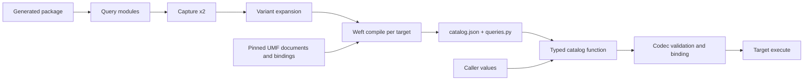

---
ddx:
  id: SD-029
  type: solution-design
  activity: design
  status: draft
  authoring:
    home: repo
  links:
    - id: FEAT-029
      kind: informed_by
    - id: ADR-004
      kind: informed_by
    - id: umf.architecture
      kind: informed_by
---

# SD-029: Precompiled typed queries and search

**Feature:** [[FEAT-029]]. **Decision:** [ADR-004](../adr/ADR-004-typed-data-access-sdk.md).
**Contracts:** [CONTRACT-071](../contracts/CONTRACT-071-query-command-catalog.md),
[CONTRACT-074](../contracts/CONTRACT-074-search.md), with
[CONTRACT-068](../contracts/CONTRACT-068-generated-python-types.md) field
expressions and [CONTRACT-072](../contracts/CONTRACT-072-runtime-targets.md)
execution.

## Scope

Stage two of the SDK build. Developers declare reads, searches and bulk commands
in Python modules over a FEAT-028 package. The `umf-access catalog` tool captures
each declaration, compiles it through a pinned Weft version for each selected
target, and writes `queries.py` and `_umf/catalog.json` into the checked-in
package. At runtime the generated query functions pick a variant, validate and
bind values, and hand the entry to a target. This design does not construct SQL;
Weft does.

## Requirements Mapping

| Requirement | Design element | Verification owner |
| --- | --- | --- |
| QC-01 | `umf_access` DSL classes: `Column`, `Predicate`, `Param`, query roots, immutable builders | US-082 / STP-082 |
| QC-02 | Generic `Column[Record, T]` and `Predicate[Record]`, operator overloads, `__bool__` refusal, generated `update()` with explicit keyword-only parameters, typed terminals | US-082 / STP-082 |
| QC-03 | Capture twice, variant expansion, Weft compilation per target, catalog writer and `--check` | US-083 / STP-083 |
| QC-04 | Generated catalog functions, variant selection, codec validation, pin match, `verify()` precondition | US-083 / STP-083 |
| QC-05 | Terminal types, keyset `Page[R, K]` with `Continuation[K]`, 1,000-row caps, `.select` overloads and per-Record `.into` overloads | US-083 / STP-083 |
| QC-06 | `s` namespace, `RankedQuery`, `Scored[R]`, embedder identity check, freshness obligations | US-084 / STP-084 |
| QC-07 | `Agg[O, T]` and `Bucket[O, T]` expressions, aggregate and bucket functions, `.select` overloads over columns, aggregates and buckets; Weft WR-A10 lowering under S11 and S12 | US-082 / STP-082 (typing); US-083 / STP-083 (results) |
| QC-08 | `starts_with`, `matches_all_terms`, `matches_any_term` predicates; keyword-index check at build; Weft WR-A11 lowering under S13 and S14 | US-083 / STP-083 |
| QC-09 | `.page(..., snapshot=True)`; table versions in `Continuation[K]`; build refusal on targets without snapshots; Weft WR-A12 | US-083 / STP-083 |
| QC-10 | Privilege report writer for `_umf/privileges.json` and per-target grant scripts | US-083 / STP-083 |
| QC-11 | Generated sync/async overloads; `AsyncReadTarget` adapters `AsyncPostgresTarget` and `AsyncLakebaseTarget` | US-083 / STP-083 |
| QC-12 | `schemaBinding: "search-path"` target configuration; Weft WR-B7 unqualified statements; `verify()` search-path resolution and `pg_catalog`-first checks; per-process verification cache keyed by target identity, database identity and resolved schemas | US-083 / STP-083 |
| QC-13 | `is_distinct_from` and `is_not_distinct_from` predicates (WR-A13); `.join(rel)` returning `Joined[O1, O2, R]` with `T \| None` columns for left joins (WR-A14) | US-082 / STP-082 (typing); US-083 / STP-083 (results) |
| QC-14 | Generated `<name>_stream` functions; one `REPEATABLE READ READ ONLY` transaction on Postgres and Lakebase; snapshot pages on Delta and Unity Catalog | US-083 / STP-083 |
| QC-15 | Keyword-only `timeout` on generated query and stream functions; required target `default_timeout`; native `statement_timeout` or driver cancellation plus a client-side deadline; `QueryTimeout` | US-083 / STP-083 |

## Solution Approaches

**Selected:** a typed expression DSL that only builds declarative descriptions,
captured at build time and compiled ahead of time through Weft. The DSL borrows
names from SQLAlchemy, Django, PySpark, Polars and Ibis so that Python data
developers recognize it. It does not borrow their execution models.

**Rejected:**

- *Conventional ORM (SQLAlchemy ORM, Django, SQLModel).* Change tracking, lazy
  loading and `save()` bypass engine protocols and do not exist on Spark.
- *Runtime query building (SQLAlchemy Core, Polars or Ibis executed directly).*
  Unsupported forms surface in production, and input handling is harder to audit.
  Apex static SOQL and Scala Quill show the same trade-off in favor of compiling
  ahead of time.
- *String references (Django lookups, pandas `query`, Polars `col("x")`).* They
  defeat type checking and schema-driven refactoring.
- *SQL generation in UMF.* Weft already owns lowering for Truss and Ashlar; one
  lowering per target is kept there.
- *Search inside the exact query type.* Salesforce keeps SOQL and SOSL apart for a
  reason: ranked results have no exact count, keyset or ordering guarantee. A
  separate `RankedQuery` type makes the type checker enforce that split.
- *Mypy or pyright plugins.* Plugins tie correctness to one checker. The DSL uses
  only standard generics and overloads so both checkers agree without plugins.

## Domain Model

A *declaration* is a decorated function whose parameters are all `Param[T]`. A
*variant* is one combination of present optional parameters; each is compiled
separately. A *catalog entry* pins Weft version, backend, target profile and
binding digest, and holds the statement, parameter carriers, output decoders and
Weft host obligations verbatim. A *bulk command* names a CONTRACT-900 action and
records a statement template plus its structural digest. A *search index* is
authored in `umf.access`; a *search binding* names the native index, its
freshness and `maxK` per target.

## System Decomposition

TD-082 owns the DSL classes, including aggregate and bucket expressions, and the
static typing corpus. TD-083 owns capture,
variant expansion, the Weft compile step, catalog and `queries.py` writing, drift
check, runtime variant selection and binding, snapshot continuations, the
privilege report, the async read adapters, schema-neutral verification and its
cache, streams and read timeouts. TD-084 owns search: index
declarations, the `s` namespace, `RankedQuery`, hybrid fusion, embedder checks,
stale-key hydration through single-key reads and score labeling. All of it lives in the `umf_access`
Python distribution; the `build` extra carries Weft's Python binding. Execution
itself is CONTRACT-072 and SD-030.

## Technology Rationale

Python generics with `Self`-returning builders, overloads and explicit
keyword-only parameters are understood by pyright, mypy and ty without plugins.
Bulk `update()` uses explicit parameters rather than `Unpack[TypedDict]` because
ty does not reject unknown keys in unpacked TypedDict keyword arguments. A local DSL
typing spike exercised several CONTRACT-071 negative rows on pyright and mypy; it
is design input, not qualification. In that spike mypy revealed `Any` for
decorated query results where pyright revealed the precise type, so the
"wrong result use" row is not yet shown on mypy. Weft's Python binding is the only compiler.
Capture uses ordinary Python import of an explicit module list; there is no
package scanning or entry-point discovery.

## Traceability

STP-082 owns static corpora on pinned pyright and mypy, including the forms
CONTRACT-071 lists as not yet covered by the typing spike. STP-083 owns capture
refusals, a positive and a Weft-blocked negative case per DSL row per target,
drift check, pin refusals and plan drift, and also `verify()` detection of column
drift and the Lakebase unlisted-minor refusal (US-083-AC5), which FEAT-030
relies on. STP-082 also owns aggregate typing (US-082-AC7), join typing
(US-082-AC8) and the ty corpus run (US-082-AC9). STP-083 also owns
aggregate and bucket exactness (US-083-AC7, Weft WR-A10), prefix and term filters
(US-083-AC8, WR-A11), snapshot and live pages (US-083-AC9, WR-A12), privilege
report sufficiency (US-083-AC10), async reads (US-083-AC11), schema-neutral
catalogs (US-083-AC12, WR-B7), the verification cache (US-083-AC13), null-safe
distinctness and joins (US-083-AC14, WR-A13, WR-A14), bounded streams
(US-083-AC15) and read timeouts (US-083-AC16). STP-084 owns search declaration
refusals, filter and `k` limits, embedder mismatch, stale-key hydration and native
search witnesses. Weft-dependent rows stay planned until the Weft capabilities
exist.

## Concern Alignment

Fidelity: authored search semantics are matched exactly or refused, never
substituted. Security: values and search text are bound parameters only; `plain`
search syntax interprets nothing. Reproducibility: catalog bytes are deterministic
for fixed pins and drift-checked. Bounded processing: declaration, variant,
parameter, page and `k` limits. No UI or telemetry slot applies.

## Constraints & Assumptions

Cross-repository Weft dependencies, not specified here: raw-table backends for
Postgres, Lakebase and Spark/Unity Catalog; search lowering; and plan templates.
Until plan templates exist, bulk commands call the pinned Weft compiler at runtime
and compare structural digests. Only Key ordering and bounded reads are admitted
in 0.1. Search mechanisms in CONTRACT-074 are candidates per platform version.

## Risks

| Risk | Impact | Mitigation |
| --- | --- | --- |
| Pyright and mypy disagree on an overload or decorator | A mistake passes one checker | Both pinned; corpus must pass on both; no plugins; resolve the spike's mypy `Any` result before qualifying |
| Weft cannot lower a form for one target | Build fails for all | `WEFT_BLOCKED` names target and variant; narrow target list explicitly |
| Optional filters multiply variants | Large catalogs | 16-variant cap per declaration |
| Runtime Weft call for bulk plans | Extra dependency and drift | Structural-digest check; replace with Weft plan templates |
| Approximate or asynchronous search surprises users | Missing or stale hits | Exactness and freshness authored and recorded in the manifest; `stale` count |
