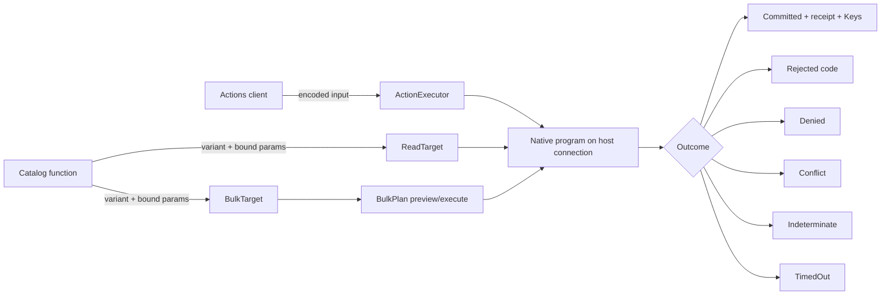

---
ddx:
  id: SD-030
  type: solution-design
  activity: design
  status: draft
  authoring:
    home: repo
  links:
    - id: FEAT-030
      kind: informed_by
    - id: ADR-004
      kind: informed_by
    - id: umf.architecture
      kind: informed_by
---

# SD-030: Typed actions and native execution targets

**Feature:** [[FEAT-030]]. **Decision:** [ADR-004](../adr/ADR-004-typed-data-access-sdk.md).
**Contracts:** [CONTRACT-072](../contracts/CONTRACT-072-runtime-targets.md),
[CONTRACT-073](../contracts/CONTRACT-073-native-sql-action-profile.md), with
[CONTRACT-068](../contracts/CONTRACT-068-generated-python-types.md) action types
and CONTRACT-900/901 action meaning.

## Scope

The hand-written `umf_access` runtime: target protocols, typed outcomes,
transport carriers, the raw-table adapters, the native SQL action profile and the
shared conformance suite. Generated `Actions` clients delegate to an
`ActionExecutor` and `ReplayingActions` clients to a `ReplayingActionExecutor`;
catalog functions delegate to a `ReadTarget` or `BulkTarget`.
This design covers the four raw-table target kinds. Truss and Ashlar adapters are
SD-031.

## Requirements Mapping

| Requirement | Design element | Verification owner |
| --- | --- | --- |
| AT-01 | Generated `Actions` and `ReplayingActions` classes; input codecs; `<Action>Rejected` | US-085 / STP-085 |
| AT-02 | `ReadTarget`, `ActionExecutor`, `ReplayingActionExecutor`, `BulkTarget`; `TargetIdentity`; `verify()`; six-way `ActionOutcome` with `ActionRefused` and `ActionFailed` | US-085 / STP-085 |
| AT-03 | `PostgresTarget`, `LakebaseTarget`, `UnityCatalogTarget`, `SparkDeltaTarget` over host-owned connections | US-085 / STP-085 (action execution); US-083 / STP-083 (reads and `verify()`) |
| AT-04 | CONTRACT-073 obligations table, build-time refusals, outcome classification, Postgres/Lakebase commit-loss reconciliation | US-085 / STP-085 |
| AT-05 | Single atomic bulk program, `AtomicBulkPlan.preview()` read-only, `execute() -> BulkOutcome`, `maxItems` refusal | US-086 / STP-086 |
| AT-06 | `umf_access.conformance` suite with injected commit loss | US-085 / STP-085 |
| AT-07 | `ActionExecutor.validate()` and generated `<action>.validate(input)` returning `ValidationResult`; Weft WR-B4 validate-only program in an always-rolled-back transaction; `Committed.created` and `Committed.changed` Key DTOs from the program's returned Keys | US-085 / STP-085 (raw tables); US-087 / STP-087 (Truss preview mapping) |
| AT-08 | `AsyncActionExecutor`; `AsyncPostgresTarget` and `AsyncLakebaseTarget` over psycopg 3's async connection; generated sync/async overloads | US-085 / STP-085 |
| AT-09 | Keyword-only `timeout` on action and bulk calls; native `SET LOCAL statement_timeout` or driver cancellation plus a client-side deadline; `TimedOut` before the commit is sent; commit-phase deadline handled by commit-loss reconciliation | US-085 / STP-085 (actions); US-086 / STP-086 (bulk) |
| AT-10 | Multi-effect actions as one CONTRACT-073 program; no cross-action transaction surface in generated clients or the runtime | US-085 / STP-085 |

## Solution Approaches

**Selected:** the host's native SQL interface is the execution layer. Actions are
compiled at build time into catalog entries whose native statement programs come
from Weft action lowering. A raw-table adapter runs those programs on a connection
the host already owns, under per-platform rules that say what each CONTRACT-900
obligation becomes. Anything a platform cannot honor refuses at catalog build or,
for runtime-only conditions such as transaction state, at invocation.

**Rejected:**

- *A separate executor service for raw tables.* It adds a deployable that owns
  credentials and state the host already manages, without adding guarantees the
  native transaction cannot give.
- *ORM unit of work.* Flush order, cascades and identity maps are hidden write
  paths and do not exist on Spark (ADR-004).
- *Uniform guarantees across platforms.* Platforms differ in atomicity and
  isolation. A single claim would be false somewhere; a per-platform table with
  refusals is honest.
- *Automatic retry of unknown outcomes.* Without a durable replay record a retry
  can apply a change twice. `Indeterminate` goes to the caller.
- *Durable idempotency or batched bulk on raw tables in 0.1.* Both need control
  state that the native SQL interface does not provide; they need a separate
  design.

## Domain Model

`TargetIdentity` is `{kind, backendId, backendVersion, targetProfile,
bindingSha256, platform versions}`. `verify()` observes server version, table
identity and column shape and compares them with the binding and ColumnSets. A
`Receipt` is `{store, epoch, version}`, comparable only within one store and
epoch. `Replayed` and `ReplayingActionExecutor` exist in the protocol, but no
raw-table target implements them in 0.1: idempotency is a static capability, and
type checking rejects a raw-table target passed to `ReplayingActions`.

## System Decomposition

TD-085 owns the generated action clients, the protocols, outcomes and receipt
types, action execution on the four raw-table adapters including commit-loss
reconciliation, the action rows of the native profile and the conformance action
cases. TD-083 owns the adapters' read path, `verify()` observations per platform
and host-obligation application. TD-086 owns raw-table bulk plans and the
conformance bulk cases. The runtime ships as one distribution with
extras: `postgresql` (psycopg 3), `databricks` (Databricks SQL connector) and
`spark` (PySpark). Hosts own connections, pools, credentials, configuration and
deployment.

## Technology Rationale

psycopg 3 offers native parameter binding and explicit transaction and isolation
control, which the Postgres and Lakebase rules (one `SERIALIZABLE` transaction on
an idle connection) rely on. On Unity Catalog,
multi-statement programs use `BEGIN ATOMIC ... END` on managed tables with
catalog commits, on qualified compute. Local Spark/Delta is limited to
single-statement programs. Authorization checks (`pg_has_role`,
`is_account_group_member`) are candidates. Exact driver and platform versions are
pinned per target; none is qualified by this design.

## Traceability

STP-085 owns client typing (including static rejection of raw-table targets by
`ReplayingActions`), outcome mapping, profile refusals (policy authorization,
`person-required` attribution on service-principal targets, handler bindings), adapter action conformance and
commit-loss injection and reconciliation, and also `validate()` reporting every
failing precondition with no effect (US-085-AC8), typed created and changed Keys
on `Committed` (US-085-AC9) and async invocation on Postgres and Lakebase
(US-085-AC10); the first two depend on Weft WR-B4. STP-085 also owns action
timeouts (US-085-AC11), multi-effect atomic actions with no cross-action
transaction (US-085-AC12) and `person-required` actions on `human`-principal
targets (US-085-AC13); STP-086 owns bulk timeouts (US-086-AC7). STP-086 owns bulk preview/execute
agreement. STP-083 owns `verify()` detection of added, dropped, retyped and
identity- or generation-changed columns and the Lakebase minor-version refusal
(US-083-AC5). Every CONTRACT-073 obligation row needs native positive and negative
witnesses per target before a platform claims action support.

## Concern Alignment

Security: only catalog statement text runs, and every value is a native bound
parameter; native privileges, row-level security, row filters and masks still
apply. Fidelity: outcomes are never upgraded; errors never become empty results
or success. Runtime isolation: adapters create no connections, sessions,
credentials, tables or migrations. No UI or telemetry slot applies.

## Constraints & Assumptions

Weft raw-table backends and action lowering are cross-repository dependencies,
not specified here. Lakebase targets pin a major version (PostgreSQL 16, 17 or
18) plus an explicit set of observed minor versions, because Lakebase applies
minor versions automatically. Databricks multi-statement transactions need Unity
Catalog managed tables with catalog commits. Role mappings are exact pinned
configuration. Verification checks shape and identity only; it does not prove the
shape stays unchanged afterwards.

## Risks

| Risk | Impact | Mitigation |
| --- | --- | --- |
| Lakebase moves to an unlisted minor version | Unqualified behavior in production | `verify()` raises `TargetMismatch` until the minor is qualified |
| Commit outcome lost on the wire | Duplicate or missing change | Reconcile with `pg_xact_status` where a connection factory exists; otherwise `Indeterminate`; never retry automatically |
| Unity Catalog receipt not obtainable from the commit result | No trustworthy receipt | Target unqualified for actions |
| Schema changes after `verify()` | Statement fails or misbehaves | Re-verify on reconnect; native errors surface unchanged |
| Weft action lowering absent or narrower than the profile | Actions unavailable on raw tables | Build refuses; reads remain usable |
