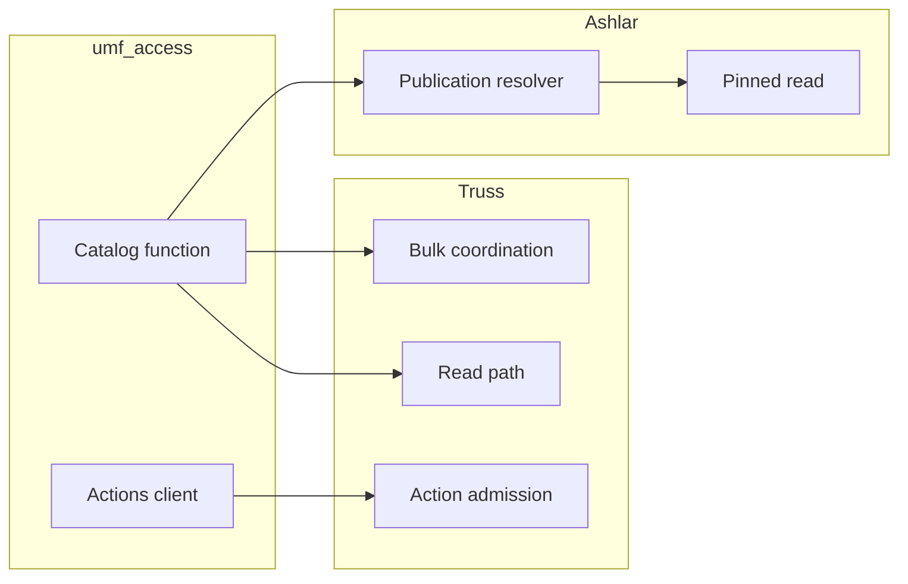

---
ddx:
  id: SD-031
  type: solution-design
  activity: design
  status: draft
  authoring:
    home: repo
  links:
    - id: FEAT-031
      kind: informed_by
    - id: ADR-004
      kind: informed_by
    - id: umf.architecture
      kind: informed_by
---

# SD-031: Engine target adapters (Truss, Ashlar)

**Feature:** [[FEAT-031]]. **Decision:** [ADR-004](../adr/ADR-004-typed-data-access-sdk.md).
**Contracts:** [CONTRACT-069](../contracts/CONTRACT-069-engine-target-adapters.md),
with [CONTRACT-072](../contracts/CONTRACT-072-runtime-targets.md) protocols and
CONTRACT-900/901/903/904 action and bulk meaning.

## Scope

The conformance boundary that lets Truss and Ashlar act as SDK targets. UMF owns
the protocols, the conformance suite, the adoption packet shape and the
engine-specific witness list. Each engine owns its adapter, its adoption design
and its execution authority. This design changes no engine storage and amends no
sibling contract.

## Requirements Mapping

| Requirement | Design element | Verification owner |
| --- | --- | --- |
| EA-01 | `TrussTarget`: reads through Truss's read path, actions through protected admission as a `ReplayingActionExecutor`, bulk through `ManifestBulkPlan` (`preview`, `seal`, `submit`) and CONTRACT-903/904; carrier mapping, `ABSENT` refusal and lexical-spelling refusal | US-087 / STP-087 |
| EA-02 | `AshlarTarget`: `ReadTarget` only, resolver-pinned execution, `Continuation[K]` bound to the publication's identity digest | US-088 / STP-088 |
| EA-03 | Engine-local adoption designs, adoption packet, conformance suite, engine witnesses, storage-access prohibition | US-087, US-088 / STP-087, STP-088 |

## Solution Approaches

**Selected:** engines implement the same target protocols as raw tables, over
their own protected paths. Weft compiles catalog entries for each engine through
its existing backend. The adapter adds no semantics: it routes catalog entries and
encoded inputs into the engine and maps results back to SDK outcomes.

**Rejected:**

- *Bind generated models to engine storage.* Truss already generates its internal
  DDL from UMF and stores domain values in generic JSONB keyed by catalog
  property IDs. Ashlar already generates its Delta DDL from UMF and stores generic
  STRING JSON columns. Neither layout is a domain table. Mapping models onto it
  would duplicate engine logic and bypass admission, journal, feed, resolver and
  fencing.
- *Latest-table reads on Ashlar.* They can mix table versions from different
  publications. Every read is resolver-pinned instead.
- *A UMF-hosted adapter for each engine.* Engines change on their own schedule
  and own their execution contracts. The adapter lives with the engine; UMF owns
  only the conformance it requires.
- *Ashlar actions or bulk through the SDK.* Ashlar writes, ACK progress and
  publication are its own protocol. Ashlar provides no `ActionExecutor` or
  `BulkTarget`.
- *Search on engines in 0.1.* Ashlar would need a separate index pinned to the
  publication version vector; neither engine has qualified search lowering.

## Domain Model

An *adoption packet* is `{contract, engine, engineVersion, adapterVersion,
runtimeAbi, catalogTargets, nativePins, authorityRefs, conformanceEvidence,
outcome}`, with `outcome` `proposed`, `qualified` or `refused`. The Ashlar target
identity includes the publication vector, so a `Continuation[K]` recording its
digest raises `StaleContinuation` on any other publication. Truss carriers include
`ABSENT` and `MISSING`, exact text tokens and `Decimal` or `datetime`; a decoded
`Decimal` keeps the value but not the authored spelling. Truss `ABSENT` for a
Field bound by a relational ColumnSet refuses with `ADOPTION_MISMATCH`. Truss
results map to SDK outcomes through the CONTRACT-072 tx/1 table; only concurrency
conflicts become `Conflict`.

## System Decomposition

TD-087 states UMF's side of Truss adoption: the conformance requirements, the
packet checks and the witness list for reads, actions and bulk. TD-088 does the
same for Ashlar reads. The adapters themselves, and their adoption designs, live
in the Truss and Ashlar repositories and run the `umf_access.conformance` suite
there with native fixtures. UMF validates the packet shape; it does not
fabricate evidence, issue engine authority or call engine internals.

## Technology Rationale

Truss reads use Weft's Truss runtime backend (currently `truss.postgresql.runtime`
with `truss-runtime-binding/0.4`). Ashlar reads use Weft's Ashlar/Databricks
backends. Ashlar instants use its epoch-microsecond text carrier. Exact engine,
backend and binding versions are pinned per adoption packet; a change to any of
them requires requalification.

## Traceability

STP-087 owns the Truss witnesses: equal admission outcomes for authorized and
unauthorized subjects, identical state, journal, feed, receipt and ACK on commit,
`Conflict` with rollback for concurrent conflicts, Truss's own classification
(confirmed rollback, raised as `ActionFailed`) for injected failures before
COMMIT, replay of equal idempotent requests, and bulk sealing, submission and
coordinated execution matching Truss's own bulk path. STP-088 owns the Ashlar witnesses: equal rows to
the resolver path; refusals for replaced or expired snapshots, renamed aliases
and identity change between resolve and read; and empty pages only for complete
empty publications, and `StaleContinuation` for continuations from another
publication. Lexical-spelling refusal (`LEXICAL_SPELLING_REQUIRED`),
`ABSENT` refusal and unpinned-publication refusal need fixtures.

## Concern Alignment

Identity and fidelity: engines keep execution authority, and any conflict refuses
until reconciled upstream. Security: no generated code receives table handles,
write-privileged connections or storage mappings; Truss still authenticates and
authorizes every action. Runtime boundaries: adapters live in engine repositories.
No UI or telemetry slot applies.

## Constraints & Assumptions

Engine-side dependencies: Truss needs a public action admission path and typed
carriers for timestamp, binary and exact values (its runtime currently refuses
entity projections with timestamp or binary fields and returns exact tokens as
text), and Ashlar needs resolver-pinned read execution usable by adapters and
decoders beyond string scalars and `published_at`. These are engine capabilities
(T-1, A-1), not specified here. Weft's existing Truss and Ashlar backends are
assumed adequate for the 0.1 DSL; any gap appears as `WEFT_BLOCKED` at catalog
build. A narrow read-only Truss adoption may ship before actions and bulk, but
its packet must state that narrower scope.

## Risks

| Risk | Impact | Mitigation |
| --- | --- | --- |
| Truss has no public action admission path yet | Actions unavailable on Truss | Adopt reads first; packet records narrower scope |
| Adapter outcome differs from engine's native path | False equivalence | `ADOPTION_MISMATCH` refuses; witnesses compare against native client |
| Exact-value spelling lost on Truss round trip | Silent lexical change | Refuse re-encoding of SDK-read values until a lexical-preserving carrier exists |
| Ashlar snapshot expires mid-read | Mixed or partial results | Identity checks before and after; refusal, never an empty page |
| Engine or Weft version moves | Unqualified behavior | Pins in packet and target identity; `NotCompiledForTarget` and requalification |
