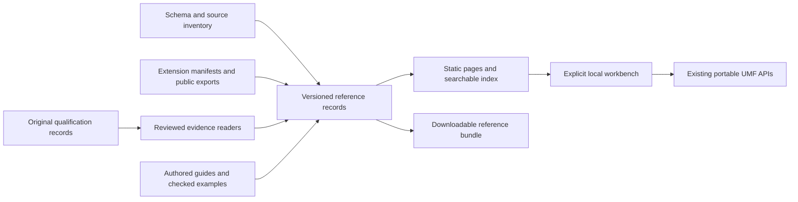

---
ddx:
  id: SD-032
  type: solution-design
  activity: design
  status: draft
  authoring:
    home: repo
  links:
    - id: FEAT-032
      kind: informed_by
    - id: umf.architecture
      kind: informed_by
    - id: ADR-002
      kind: informed_by
    - id: umf.concerns
      kind: references
---

# SD-032: Generated reference and microsite expansion

**Feature:** [[FEAT-032-generated-reference]].
**Story:** [US-089](../../01-frame/user-stories/US-089-generated-reference.md).
**Contract:** [CONTRACT-077](../contracts/CONTRACT-077-generated-reference.md).

## Scope

Provide one navigable reference over core schemas, shipped extensions, public
APIs, integration evidence and executable examples. Generate structural facts
from code and schemas; write explanation where structure cannot express meaning.
The output is a static, downloadable metadata product consumed by the microsite.
It is not an alternate UMF metamodel or a new compatibility authority.

## Requirements Mapping

| Feature requirements | Capability | Verification |
| --- | --- | --- |
| REF-01/02 | Complete discovery census, versioned schema graph and structural comparison | Inventory additions, reference closure and profile-diff controls |
| REF-03/04 | Manifest/API inventory joined to reviewed registration, guides and examples | Manifest/schema equality, export resolution, example execution |
| REF-05/06 | Operation-level evidence with independent outcome and correspondence | Historical, incomplete, conflicting and tampered evidence controls |
| REF-07 | Shared navigation, search, stable routes and original sources | Nested-base-path and keyboard/mobile browser journey |
| REF-08/09 | Fixed local workbench with explicit registries and preservation | Bun/Chromium parity, loss/refusal/cancellation controls |
| REF-10 | Deterministic artifact ownership and signed publication closure | Nonmutating check, two-build comparison, served digest checks |

## Solution Approaches

**Selected: deterministic build-time reference with authored overlays.** Local
discovery produces source-bound records, then generation emits a small index,
detail shards, HTML, exact-source assets and an integrity manifest. Browser
interaction queries those records and runs explicitly packaged portable tools.
This reuses the site's static hosting, Bun toolchain and existing example checks.

**Hand-maintained reference tables** are easy to start but repeat the current
drift and cannot establish inventory completeness. **Runtime repository crawling**
adds network availability, branch drift and browser parsing cost without making
evidence more trustworthy. Neither is selected. A separate documentation framework
or service adds a dependency boundary without a demonstrated need.

**Trade-off:** evidence families require small reviewed readers and mappings;
the build cannot safely infer outcomes, semantic coverage or freshness from
arbitrary JSON keys, filenames, test counts or prose. Unmapped evidence stays
visible and unassessed. This costs curation but prevents automatic overclaiming.

## Domain Model

Definitions describe structure; extensions describe declared participation;
operations describe a named capability and subset; evidence describes recorded
observations; examples connect a bounded operation to admitted inputs. None
inherits support merely because another record references it. Exact identities,
joins, provenance and conflict rules belong to CONTRACT-077.

## System Decomposition

Architecture's [reference consumer map](../architecture.md#generated-reference-consumer-boundaries)
owns the four module boundaries. [TD-089](../technical-designs/TD-089-generated-reference.md)
realizes the vertical journey across extraction, rendering and runtime bridges.

The build inventories all configured schema families and exported symbols, then
joins curated profile, registration and evidence mappings. The model retains
original paths, pointers and digests. Renderers consume this model without
parsing contracts or deciding what a native result proves.

The site provides Core, Extensions, Integrations, API and Examples under Reference.
Core explains envelope/identity, Field/Record/group, value families, nullability,
cardinality, facets, Keys, relationships, literals/defaults and version migration.
It distinguishes declarations from native enforcement. Extensions include DDD,
binding, actions, security, access, dashboard, domain packs and native vocabularies;
all manifest versions are listed even when runtime or evidence mapping is absent.

Integrations have separate operation rows for import/export, edited round trips,
classification, projection, browser execution and consumer execution where such
records exist. TableSpec/PostgreSQL/SQL Server/Avro/Parquet remain visible as
priority bindings. JSON Schema/Protobuf and the wider native inventory are not
collapsed into one support grade. Typed SDK and ecosystem records retain their
own scope; local PostgreSQL/Delta evidence cannot qualify managed services.

Workbench profiles cover current-core inspection/validation/serialization,
metadata selection, explicit extension registration, structural profile comparison,
and a bounded JSON Schema-to-Protobuf projection demonstration. Native schema
semantic validation and optional Protobuf source compilation expose their actual
runtime requirements; they are not silently enabled by source inspection.

## Concern Alignment

ADR-002 keeps host I/O in build tooling and requires actual-browser evidence.
Fidelity retains exact source and unknown payloads. Identity uses versioned
references, never display-name joins. Reproducibility pins the complete input
closure. Bounded processing uses lazy shards, fixed validators and cancellable
workers. Conformance separates metadata validity from tested capability. Review
uses focused generated diffs and explicit module boundaries. Durable adoption
provides machine-readable artifacts without requiring this site's renderer.
No formal-methods or OpenTelemetry concern is selected for this static slice.

## Constraints, Risks and Assumptions

Existing semantic contracts, DESIGN.md, schema-browser HOST_CONTRACT.md and page
signature custody remain authoritative. No schema-browser package internals are
forked. Navigation and new generated routes require extending the existing public
signature coverage before publication. The default registry and low-level empty
registry are documented separately.

Incomplete historical dependency closures may prevent current-source evidence
labels indefinitely; displaying historical results is acceptable. Browser fixed
validators may lag newer profiles; the runtime inventory must expose that gap
and add the required validators before claiming that profile executes. Large
source graphs require sharding; limits fail explicitly instead of truncating.

This design selects no new external service, dependency or release date.
Contract limits and browser budgets are proposed acceptance targets to measure
during implementation. New evidence families can be added independently using
the same exact allocation and negative-control requirements.

## Reader organization

REF-11–14 use a manifest-bound reader companion over unchanged exact reference
entries. Concept navigation defaults to latest core; property explanations and
conditional rules precede source details. API task groups and symbol-specific
layouts precede full declarations. The reader companion owns presentation and
search metadata; canonical schemas/contracts/compiler symbols own facts.

## Current documentation amendment — 2026-10-18

Owner direction supersedes historical core browsing, core-profile selection and
migration-oriented reader requirements above. Document core 0.10.0 as the single
current schema: no core version picker, history catalog or version badges. Old
core links resolve to the current schema and preserve valid pointers; invalid
pointers refuse visibly. Original source inventories and native/extension evidence
keep their truthful identities and qualification; historical evidence is not
relabelled as current support.

Workbench examples use core 0.10.0 and open as YAML, with accessible YAML/JSON
buttons converting current edited values through the public interoperable
serialization API. Malformed, duplicate-key or inexact values refuse without
replacing input. Cancellation and input edits invalidate pending conversion.
Original bytes remain downloadable. Native Protobuf keeps its own syntax.
Property/default execution APIs restricted to earlier envelopes are not offered
by the current workbench; their API declarations retain their original limits.
Every schema disclosure starts collapsed, including complete examples. Explicit
user expansion and format switching remain keyboard accessible.

Acceptance: verify all supplied examples execute, format parity after edits,
conversion refusal and cancellation, current-only navigation, old-link recovery,
and zero initially open schema disclosures in Chromium at desktop/mobile widths.
