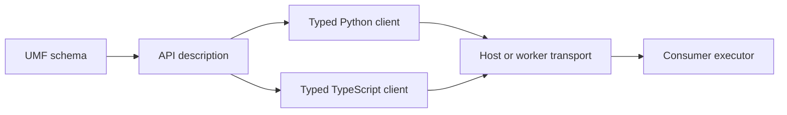

---
ddx:
  id: SD-033
  type: solution-design
  activity: design
  status: draft
  authoring:
    home: repo
  links:
    - id: FEAT-033
      kind: informed_by
    - id: umf.architecture
      kind: informed_by
    - id: ADR-002
      kind: informed_by
    - id: ADR-004
      kind: informed_by
---

# SD-033: One generated data access API

**Feature:** [FEAT-033](../../01-frame/features/FEAT-033-generated-ontology-access.md).

## Scope

The developer supplies their UMF schema and generates one typed query/action
API. Tables and ontologies share model query builders, relationship traversal,
keys and action methods. The injected binding handles storage and execution.

## Solution Approaches

Generate a language-neutral API description from UMF, then emit Python and
TypeScript from that description. This keeps both languages aligned and gives
host and worker one request/response contract. Direct generation from Hohfeld's
resolved plans would couple the API to executor internals. Requiring the table
SDK's authored views and Python dependencies would prevent stdlib-only plugins.

Select runtime expression composition for both storage forms. Expressions are
inert schema-referenced request data; terminals execute through the binding.
Applications need no decorated query functions or `Param` declarations.

Mandatory precompiled query functions add a second abstraction without improving
ordinary typed reads. Preparation/caching may remain an internal optimization or
an optional reusable-query feature. SQL lowering stays with the consumer binding,
through Weft where used, and values remain bound parameters. The stdlib-only
generated client builds no SQL.

## Domain Model

## Design decisions

### One model query builder, one binding per client

Generate `Model.objects` for every storage backend. Bind it explicitly to a
client, then compose typed filters, ordering, key selection and relationship
traversal. Terminals return typed values. Key selection composes with traversal
so following one order's customer needs neither an inverse predicate nor a
wrapper function. No model stores global mutable connection state.

Generate one typed Actions client for declared actions. The binding translates
the same query/action requests into SQL, ontology execution or remote calls.
Backend limitations refuse explicitly without changing the Python API. Exact
method signatures belong in the shared access Contract.

### Use the current UMF

Use UMF's current reader and declarations for entities, fields, keys,
relationships and actions. Determine input versions from documents automatically.
The generator follows the latest model; it does not require users to choose or
name a historical dialect. Version checks prevent misinterpretation of input,
not add configuration steps.

Ontology consumers implement the generated API's host binding against UMF
0.10.0. UUID, opaque 128-bit values and semantic references retain their current
UMF meaning.

### Derive access information

Generate directly from the declarations already in the schema. Infer only what
those declarations establish, with useful deterministic naming and API defaults.
Select a default identity only when UMF declares one unambiguously. Include
referenced key/value types without exposing more operations.

Derive create/patch shapes from actions. Preserve whether each action takes a
value from its caller, assigns a literal/default, generates it, omits it or
unsets it. A field generated in one action may be caller-supplied in another.
Keys stay immutable within an entity's lifecycle. A missing inverse name gets a
stable generated name; multiplicities come from the actual relationship ends.
Missing essential meaning produces a concrete schema diagnostic.

### Define invocation documents, not client-authored plans

Clients send an action identity and typed inputs. The host resolves that action
against the schema and evaluates its conditions/effects. It returns typed
results, change counts, affected keys and an opaque consistency token.
Hohfeld's binding maps these calls to its authoritative resolver and receipts.
Client-supplied effects never authorize mutation. Validation uses the same path
without applying changes and remains advisory.

### Keep one plugin calling convention

Generate explicit synchronous and asynchronous clients from the same operation
model and wire contract. Client/Actions remain the async compatibility names;
AsyncClient/AsyncActions make that mode explicit, while SyncClient/SyncActions
use a synchronous transport Protocol. Query binding selects typed synchronous
or asynchronous terminals. Scheduling mode is explicit at the application
boundary; changing storage within that mode does not change application calls.
Neither mode manages event loops or embeds a production transport. This amends
the original async-only convention following the 2026-10-18 Praxis P1 request.

### Preserve values and make errors useful

Generate frozen dataclasses, typed entity keys, immutable collections and an
explicit missing-value sentinel. Omitted patch values, null and explicit unset
remain different. Use exact integers/decimals and typed text carriers when a
Python datetime would lose precision or lexical meaning. TypeScript preserves
the same values rather than passing large integers through JavaScript numbers.
A small stdlib-only codec helper is emitted with the package.

Business failures have fixed codes, typed field/precondition identifiers and
messages without instance data. Keep transport failure, unsupported operations,
unmet freshness and possible commitment distinct. After dispatch, cancellation
or a lost response cannot establish rollback. Retain invocation identity and
never retry automatically. The executor owns durable replay and reconciliation.

### Supply bounds and honest batches

Default page/get-many/batch limits to 100 and record the effective settings in
the description. Hosts may reduce them. Filter/order operators follow the actual
field meanings and host capabilities. Ordinary limit settings need no named
compatibility configuration.

Each batch explicitly requests atomic or partial execution. Unsupported modes
refuse before effects. Atomic means all-or-none; partial batches report ordered
per-item results, including unknown or unattempted items. Idempotency guarantees
must cover the actual invocation or batch, not be inferred from a key's presence.

### Read changes and page predictably

Offer latest and replica-eligible reads with an optional at-least token. A host
must meet the requested freshness or fail explicitly. Tokens retain issuer and
module context; positions from different issuers are not assumed comparable.

Cursors bind the query, selection, ordering and applicable snapshot/revision.
Use key tie-breaking for stable supported orderings. State whether paging uses
a snapshot or live data. Expired/foreign cursors fail instead of returning a
misleading empty page. Link-key inclusion remains subject to host authorization.

### Regenerate and review

Retain exact source text and stamp generated output with source digest,
description identity and tool versions automatically. A whitespace edit changes
provenance without necessarily breaking the API. Compare field/key/link/action
changes, supported operators, limits and behavioral promises conservatively;
explain breakage and refuse unsupported comparisons.

Checking is read-only and byte-exact. Regeneration refuses edited owned files
and replaces output atomically. Generated names use literal escaping and
collision checks. Schemas never select executable templates or network sources.

### Test the client and the binding

Ship an in-memory fake and run the same assertions against real bindings.
Cover exact values, absence/null, typed errors, paging/tokens, bounds, atomic and
partial batches, replay and lost responses. Run unchanged plugin source across
local/remote transports and sync/async backends. Fake success does not substitute
for testing the host implementation.

## System Decomposition

| Component | Responsibility |
| --- | --- |
| API derivation | Read current UMF; derive selected types/operations and diagnostics |
| Code generation | Emit Python/TypeScript types, codecs and transport calls |
| Output writer | Check drift and replace generated files safely outside the browser library |
| Test support | Provide the fake and shared binding assertions |
| Consumer binding | Carry calls, adapt scheduling and invoke the authoritative executor |

The portable generator remains TypeScript under ADR-002; generated Python has
no third-party runtime dependency. FEAT-028–031 supply existing compiler/runtime work. ADR-004 now places their
backend execution responsibilities behind the common API.

## Requirements Mapping

| Requirements | Component / verification |
| --- | --- |
| OA-01/03/04/05/09/21 | API derivation; current UMF examples, dependency closure, diagnostics and defaults |
| OA-02/13/14/15/16/17/18/19 | Code generation/writer; isolated imports, three-checker corpus, exact-value vectors, deterministic Bun/Chromium output and drift |
| OA-06/07/08/10/11/12 | Consumer binding; shared wire examples, unchanged plugin calls, failures, paging, batches and lost responses |
| OA-20 | Test support; the same assertions against fake and consumer bindings |

## Traceability

US-091 covers deriving/reviewing the API; US-092 covers generating/using the
client. The original Praxis request remains source material.
[CONTRACT-079](../contracts/CONTRACT-079-unified-python-access.md) specifies the
implemented Python and transport surface. The [implementation evidence](../../04-build/evidence/unified-python-access.md)
records tested behavior and remaining feature requirements. The generator lives
in UMF; SQL compilation and PostgreSQL carrier admission live in Weft.

## Concern Alignment

Preserve exact/unknown content and relevant dependency meaning; bound processing
and keep metadata inert. Test reproducibility and real-browser behavior. The
host owns authorization, execution and diagnostic capture. These existing UMF
constraints apply without additional setup steps for the developer.
