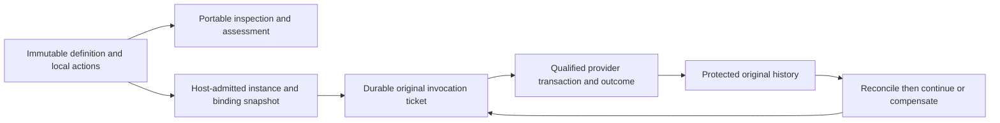

---
ddx:
  id: SD-901
  type: solution-design
  activity: design
  status: draft
  authoring:
    home: repo
  links:
    - id: FEAT-901
      kind: derived_from
    - id: umf.architecture
      kind: informed_by
    - id: ADR-006
      kind: informed_by
    - id: CONTRACT-908
      kind: references
    - id: SPIKE-901
      kind: informed_by
  schemas:
    - id: umf.actions.saga
      version: "0.1.0"
      title: Saga declarations
      path: docs/helix/02-design/contracts/schemas/saga-0.1.0.schema.json
      schemaFormat: json-schema
    - id: umf.actions.saga.protocol
      version: "1"
      title: Saga logical protocol
      path: docs/helix/02-design/contracts/schemas/saga-runtime-1.schema.json
      schemaFormat: json-schema
---

# SD-901: Portable saga declarations and consumer coordination

**Feature:** [[FEAT-901-saga-semantics]].
**Artifact:** `docs/helix/02-design/solution-designs/SD-901-saga-semantics.md`.
Exact surfaces belong to CONTRACT-908.

## Scope

Complete the UMF semantic and consumer-protocol design for the sequential profile.
The portable library provides no scheduler, service, transaction manager or UI.
Batten is an intended independent host, not a prerequisite for understanding or
implementing the vocabulary. Host-specific production architecture remains owned
by that host; the native conformance obligations here are required for its claims.

## Requirements Mapping

| Requirement | Capability | Owner |
| --- | --- | --- |
| SAGA-01–06 | Ordered definitions, typed local references, explicit recovery dispositions and outputs | TD-906, CONTRACT-908 |
| SAGA-07–17 | Durable original custody, uncertainty barrier, fenced admission, cancellation, retirement and protected history | TD-905, CONTRACT-908 |
| SAGA-18–22 | Preservation, layered assessment, external-effect refusal, limits and independent evidence | Both story designs and test plans |
| SAGA-23 | Scoped submission identity, original-result recovery and changed-intent conflict | TD-905, runtime schema |
| NFR-1/8/11/13/20/50 | Preserve competing meaning, exact offline inputs, implementation neutrality, explicit diagnostics, host-owned execution | Shared Rust library and inert schemas |

## Solution Approaches

**Selected: companion vocabulary plus explicit host protocol.** Compose existing
current-core models and actions in one supplied immutable Document. Local action
references keep their existing meaning while trusted aliases bind them to separate
stores. Shared validation uses the existing Rust action inspection family under
ADR-006; browser/Bun bindings remain required under ADR-002. The cost is a bounded
first profile and explicit qualification of each provider/binding combination.

**Rejected: put saga execution in UMF core.** This couples the interchange model
to durable scheduling, authority and databases and violates NFR-50.

**Rejected: annotate existing handlers as external effects.** Actions 0.1.0 still
requires single-store atomicity; an annotation cannot change that contract.

**Deferred: URL-resolved cross-document packages, parallel graphs and choreography.**
The first profile packages every declaration in one Document, in explicit order.
This supports multi-provider composition without adding another resolver or DSL.

**Architecture/ADR impact:** the architecture's saga module-boundary section adds
one portable operation family and consumer boundary. ADR-002/005/006 stand;
no new runtime, deployment provider or authentication architecture is selected.

## Domain Model

A definition is intent; an instance is trusted host custody; a ticket is one
original dispatch obligation; provider outcome is business truth; coordinator
history is its protected observation. A compensation is another authorized action.
The host never substitutes observation absence for provider noncommit.

## System Decomposition

| Component | Responsibility | Interface authority |
| --- | --- | --- |
| Existing core/registry | Exact immutable Document, installed package interpretation and unknown-content retention | CONTRACT-001/040/049 and ADR-005 |
| Rust saga analysis | Local reference/type/order checks, obligations, safe copy/edit and capability assessment | CONTRACT-908; TD-906 |
| Native/Bun/browser wrappers | Exact host-value admission and shared Rust transport; no semantic fork | ADR-006 and existing wire conventions |
| Host coordinator | Durable submit/control custody, ticket order, cancellation, fences and protected history | CONTRACT-908; TD-905 |
| Installed provider gateway | Current action admission, business invariants and atomic original tx/1 outcome | CONTRACT-900/901 |
| Conformance harness | Independent provider observations and original-history comparison | STP-905; no production orchestrator |

## Technology Rationale

The retained TypeScript action analysis is inspected as a differential reference;
`crates/umf-codegen/src/actions/mod.rs` already contains shared Rust action
inspection. Add saga analysis as a child of that family rather than duplicating
its value/reference rules in TypeScript or Python. Browser host code stays
TypeScript compiled to JavaScript, loading the same Rust WASM semantics. Bun
remains the JavaScript development/test runner. Rust placement follows current
main's ADR-006, which supersedes the earlier TypeScript engine preference.

The proposal JSON Schemas are design authority for their structures and are
explicitly unregistered. Production promotion goes through authored metamodel
and generated package/type workflows; no hand-maintained parallel generated model.

## Traceability

[STP-906](../../03-test/test-plans/STP-906-author-and-assess-sagas.md) maps every
portable story criterion. [STP-905](../../03-test/test-plans/STP-905-saga-recovery-conformance.md)
maps every consumer criterion. The design-schema verifier exercises structural
examples only. [SPIKE-901](../spikes/SPIKE-901-saga-recovery.md) records the bounded
TLC evidence and residual gaps. None of these artifacts marks future native tests
as passed or declaration claims as authorization.

## Concern Alignment

Fidelity, exact vocabulary identity, offline processing, bounded work and explicit
diagnostics remain mandatory. Formal methods is adopted only for saga coordination:
finite executable safety/progress analysis with named assumptions and native
correspondence obligations. It is not a new requirement on unrelated UMF work.
Architecture records allowed imports and the future boundary-check adoption.
No interactive UI is designed; Batten screens remain consumer work.

## Constraints & Assumptions

The selected declaration subset is core 0.10.0/actions 0.1.0 with current tx/1
meaning. All model/action dependencies are in one original Document. Initial
automatic fresh business retry count is zero; finite lookup/time/storage caps are
selected in CONTRACT-908. These caps select safe refusal behavior, not workload
or latency service commitments. Original custody and nonreuse last for the trusted
namespace lifetime; no automatic data deletion is introduced.

The first native qualification target is the existing bounded PostgreSQL reference
consumer, exercised with isolated coordinator and two target stores. The test run
must pin actual binary/build, adapter and source digests; no version-independent
PostgreSQL or production support is claimed by this selection. Other providers
can implement the same contract with independent evidence.

## Risks

| Risk | Mitigation |
| --- | --- |
| Coordinator/provider commit gap | Persist original ticket/custody; independent provider atomic outcome; block later work until reconciliation. |
| Incorrectly treating a queued ticket as native admission | Preserve separate native current-authority/revision checks; explicitly test retirement between ticket and provider admission. |
| Provider cannot bound outcome/custody | Refuse eligibility before effects; reserve capacity and test the outcome boundary. |
| In-flight retirement blocks compensation | Retain facts and pending obligations; intervention without implicit rebind or new privilege. |
| Model pass mistaken for implementation proof | Separate all abstract properties, structural examples, planned semantic suites and native witnesses. |

## Review Readiness

The review packet contains requirements, exact proposal schemas and protocol,
solution/story designs, exhaustive AC mappings, structural example checks and
bounded formal evidence. No unresolved decision blocks the selected profile's
semantic implementation. External declarations, production host implementation,
provider qualification, workload SLOs and release approval remain separate work.

**Identity migration:** the reviewed authoring story originally used US-904.
Current main already assigns US-904 to extension-defined kinds. This packet
explicitly migrates the saga story and all its AC citations to US-906, preserving
its content, other frontmatter and historical source hashes. US-905 remains the
recovery story. CONTRACT-908 avoids current main's CONTRACT-906/907 allocations.
