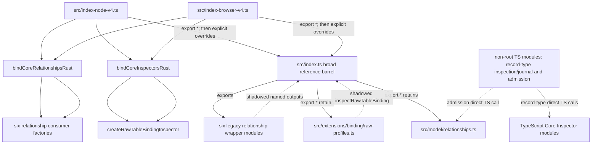

---
ddx:
  id: umf.evidence.rust-migration.r8-default-inspector-relationship-callsite-audit
  type: evidence
  activity: build
  status: draft
  authoring:
    home: repo
  links:
    - id: umf.plan.rust-migration
      kind: informed_by
    - id: umf.evidence.rust-migration.r8-core-inspectors-installed
      kind: informed_by
    - id: umf.evidence.rust-migration.r8-symbol-inventory
      kind: informed_by
    - id: CONTRACT-001
      kind: informed_by
    - id: CONTRACT-040
      kind: informed_by
---

# R8 default Core Inspector and Relationship callsite audit

## Scope and evidence boundary

This is a source-path audit of the shared working tree after the six
relationship-consumer factories were introduced. It is not a clean-commit or
installed-package qualification. The installed replay in
[`r8-core-inspectors-installed/current-5e7138383-20261026`](../r8-core-inspectors-installed/current-5e7138383-20261026/README.md)
is pinned to clean source commit `5e7138383e0e613a63b093b895835432c0570ebd`,
closure SHA-256
`138b719c1b2e099b636de1b12b0cee7201fdec483d30d8d59d9d274fe315816e`, and
archive SHA-256
`7e9bc9c1de4ff519d91f1fde6b0c6b30bde367a8d5c6aa5f610d018a247520b8`.
Later working-tree consumer edits are outside that archive's cohort. No
retirement is claimed here.

## Callsite graph

The V4 roots construct the default Inspector functions from
`bindCoreInspectorsRust` and pass the resulting Rust-bound
`inspectCoreRecordMembers` into `createRawTableBindingInspector`:
[`src/index-node-v4.ts`](../../../../../../src/index-node-v4.ts#L39) and
[`src/index-browser-v4.ts`](../../../../../../src/index-browser-v4.ts#L39).
They construct Relationship operations with `bindCoreRelationshipsRust`, then
pass Rust `lookupCoreRelationship` and `verifyCoreRelationshipOperation` into
all six consumer factories (Avro, TableSpec, SQL Server, Parquet, extras,
PostgreSQL). Their explicit export lists override matching names from the
broad `export * from './index'`.

### Direct TypeScript edges

| TS declaration or callsite | Edge | Default-root status |
| --- | --- | --- |
| `src/extensions/binding/raw-profiles.ts:2,8` | Imports `inspectCoreRecordMembers` from `src/model/record-members.ts`, then constructs `inspectRawTableBinding` with it. | The root barrel exports this module (`src/index.ts:473`), but both V4 roots explicitly replace `inspectRawTableBinding` with a closure built from the Rust inspector. The profile constants/types remain ordinary exports. This is a shadowed reference implementation in V4, not the selected default call. |
| `src/core-ideals/relationship-{avro-projection,tablespec-projection,sqlserver-projection,parquet-projection,extras,postgresql}.ts:2` | Each legacy wrapper imports TS `lookupCoreRelationship` and `verifyCoreRelationshipOperation` from `src/model/relationships.ts`. | `src/index.ts:356-366` exports these wrappers; V4 roots explicitly replace their overlapping projection/verify/recover names with the six factory outputs supplied Rust operations. The legacy modules remain bundle-retained through the barrel. |
| `src/model/relationships.ts:78` | TS `verifyCoreRelationshipOperation` replays TS `declareCoreRelationship`, `lookupCoreRelationship`, or `inspectCoreRelationships`. | Reference implementation selected by `./reference`; V4 roots explicitly export the Rust-bound relationship operation set. |
| `src/compilation/admission/index.ts:7,62` | Imports and calls TS `inspectCoreRelationships` while preparing an access view. | Not imported or re-exported by `src/index.ts` or either V4 root. It is a direct TS edge for deep/internal use, not a default package-root callsite. |
| `src/model/record-type-inspection.ts:11,24` | Imports and calls TS `inspectCoreReferenceLinks`. | Not root-exported and no production import from the V4 roots was found. |
| `src/model/record-type-journal.ts:14,42` | Imports and calls TS `inspectCoreReferenceLinks`. | Not root-exported and no production import from the V4 roots was found. |
| `src/model/relationship-selection.ts:21` | Implements `selectCoreRelationships` independently in TS; it imports relationship types only. | Explicitly root-exported at `src/index.ts:353` and retained by V4 `export *`. It does not call the Inspector/Relationship declaration operations. It remains a separate TS API and is outside direct declaration retirement. |

The declarations themselves remain in `src/model/scalar-type.ts:16`,
`record-members.ts:17`, `reference-links.ts:17`, and
`relationships.ts:45,52,59,76`. `src/index.ts:349-350,478-480` exposes the
relationship operations and three Inspector modules to the reference root.
Neither record-type inspection/journal nor compilation admission is exported
there. V4's broad export-star is still a static retention edge: output bundle
bytes include the TS implementation bodies even where the V4 explicit export
selects a Rust-bound function. Retention alone is not evidence that default
calls execute those bodies.

## Proposed bounded retirement tranche

1. **Close default-route source edges.** Keep the six consumer functions
   factory-backed and verify their V4 construction edges remain injected. For
   raw profiles, keep the V4-bound inspector selection; do not treat the
   separately exported factory as proof that the default root chose TS.
2. **Separate route exports before deleting implementations.** Replace or
   narrow the V4 `export * from './index'` path so default bundles do not
   retain reference-only Inspector/Relationship modules. Preserve the existing
   TypeScript `./reference` surface and its deliberate behavior.
3. **Resolve non-root direct callers.** For record-type inspection/journal and
   compilation admission, either inject the default operation into a supported
   default route, or explicitly keep these modules reference/internal and
   document their deep-import status. They currently do not block the
   package-root default call path, but they do block deleting the TS
   declarations while those source modules still depend on them.
4. **Retire only after route-specific evidence.** Re-run source import/call
   graph checks and installed Node/Bun/Chromium default-versus-reference
   behavior/error and host-shape replays on the new source cohort. Verify
   default package exports resolve to Rust bindings, reference exports remain
   available, and generated/member manifests have no unexplained reference
   implementation retention. Keep `selectCoreRelationships` as a separate
   TypeScript operation unless a distinct port and evidence tranche covers it.

This tranche is limited to direct Inspector/Relationship declarations and
reference-bundle route separation. Passing the existing bounded installed
replays is necessary compatibility evidence, not proof of source retirement,
exhaustive host parity, full SDK support, or release readiness.
